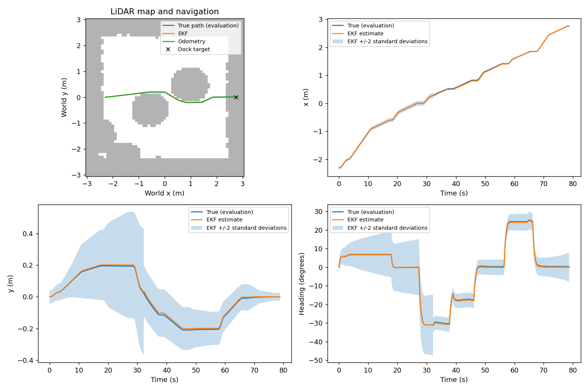
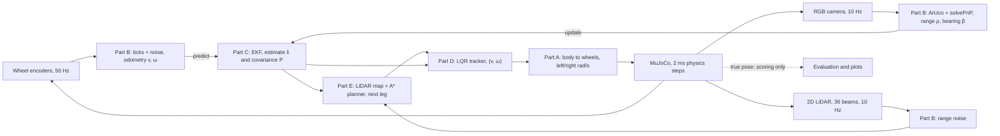

# TurtleBot3 visual docking: 41014 Assessment 4, Group 100

A TurtleBot3 Waffle Pi in MuJoCo crosses a room with boxes using its 2D LiDAR, then docks in front of an ArUco-marked charging station using its camera. An EKF fuses wheel-encoder odometry with the camera's range and bearing to the marker, and an LQR trajectory tracker drives on the EKF's estimate. The simulator's true pose is used only to score the runs.

**Track A: mobile robot, visual waypoint navigation** (simulation)

- Project page, with the demo video, frame diagram and results: <https://an-dre.github.io/41014-Sensors-and-Control-in-Mechatronics-Systems-Assessment-4-Integrated-Project/>
- Repository: <https://github.com/An-dre/41014-Sensors-and-Control-in-Mechatronics-Systems-Assessment-4-Integrated-Project>

## Team

Group 100, Spring Semester 2026. Each part has its own folder and write-up.

| Member | Contribution |
|---|---|
| Gabriel Surya | **Part A, modelling:** unicycle model, Jacobians, LQR error model, measurement model, controllability and observability analysis. Made the demo video. |
| Dinel Atapattu | **Part B, sensing:** encoder and LiDAR noise models, camera calibration in simulation, ArUco detection and frame conversion, measured camera noise R. |
| Abdurehman Nasir (Abdul) | **Part C, estimation:** the EKF, its noise tuning and consistency study. **Part E, integration (first version):** simulator interface, sensor adapter, LiDAR map and A* planner, the integrated pipeline. |
| Andre Arredondo | **Part D, control:** LQR trajectory tracker, docking logic and its closed-loop test bench. **Part E, integration (final version):** robustness study, final integration and repository. Project page. |

## Results at a glance

| What was tested | Result | Details |
|---|---|---|
| **Whole system, nominal:** rendered camera, LiDAR map and A*, EKF and LQR, from three starts with three seeds each, each with a random 2 cm / 1.5° placement error the EKF isn't told about | 9/9 docked within 3 cm along, 2 cm sideways and 3° (worst: 0.24 cm, 0.28 cm, 1.2°), with no collisions; EKF position error 3.32 cm RMS against 8.95 cm for odometry alone (63 % less) | [Part E](part_e_integration/PART_E_INTEGRATION.md#nominal-trials) |
| **Robustness:** camera loss, a weak motor, LiDAR noise, placement error and encoder noise, each pushed until it breaks: 16 disturbed conditions × 3 seeds | 33 of 48 docked. It copes with 30 s of camera loss, a left motor at 60 %, 3× Part B's LiDAR noise, 6× the placement error and 30× the encoder noise. It fails with 40 s or more of camera loss (docks on odometry alone, 5–8 cm to the side), a 50 % motor (2.3 cm to the side) and 10× the LiDAR noise (phantom obstacles block every path); each failure is traced to its cause | [Part E](part_e_integration/PART_E_INTEGRATION.md#robustness-study) |
| **Estimator** (Part C): tuning study on identical sensor logs, then fresh seeds | On nine fresh seeds: 9/9 docked, EKF position error 3.60 cm RMS against 9.53 cm for odometry alone (62 % less), NEES 0.94 (conservative). Part B's measured R gave the same accuracy and rejected more bad readings, but under disturbances its tight gate locked out good ones, so the design values were kept | [Part C](part_c_estimation/PART_C_ESTIMATION.md) |
| **Controller** (Part D), on its own test routes | 90/90 docked with the fast camera stand-in and 30/30 with the rendered camera; docking error 0.06 ± 0.07 cm along, 0.01 ± 0.15 cm sideways and −0.07 ± 0.64° over the 90 | [Part D](part_d_control/PART_D_CONTROL.md) |
| **Camera** (Part B) | Calibrated focal length within 0.1 px of the true value (0.097 px reprojection error); range bias about 10 mm and spread under 7 mm out to 2 m; measured R of 12.3 mm and 0.021° | [Part B](part_b_sensing/PART_B_SENSING.md) |
| **Model** (Part A) | Within 1 cm and 1° of the MuJoCo robot over 1 m of travel or a full turn, once its floor contact is corrected (38 cm and 106° off without) | [Part A](part_a_modelling/PART_A_MODELLING.md) |



## How it works



The coordinate frames (world, robot base, camera, LiDAR, marker) and the transforms between them are drawn in [`part_b_sensing/frames.svg`](part_b_sensing/frames.svg). Every 20 ms the encoders give odometry for the EKF's predict step. Every 100 ms the camera gives range and bearing to the marker for the update step, when the marker is in view, and the LiDAR adds obstacles to the map. The EKF uses Part C's design noise Q and R; Part C's study tried Part B's measured camera noise as well and kept the design values for robustness. The planner hands the LQR one straight leg at a time to a pre-dock point 0.9 m before the docking pose, then the straight final approach along the marker's normal. The controller only ever receives the estimate x̂.

## Repository layout

```
main.py                    the file to run: the whole system (code in part_e_integration/pipeline.py)
requirements.txt           pinned packages for a fresh environment
part_a_modelling/          Part A: model.py, validatemodel.py, PART_A_MODELLING.md, results_part_a/
part_b_sensing/            Part B: sensing.py, frames.svg (frame diagram), PART_B_SENSING.md,
                           results_part_b/ (calibration, R files, tables)
part_c_estimation/         Part C: ekf.py, evaluate_estimator.py, test_ekf.py, PART_C_ESTIMATION.md, results_part_c/
part_d_control/            Part D: controller.py, run_tracking.py, test_controller.py, PART_D_CONTROL.md, results_part_d/
part_e_integration/        Part E: pipeline.py, navigation.py, sensor_adapter.py, sim.py, robustness.py,
                           test_pipeline.py, PART_E_INTEGRATION.md, results_pipeline/, results_robustness/,
                           results_robustness_measured_R/
robotis_tb3/               the robot and scene: sceneforturtle.xml, calib_scene.xml, turtlebot3_waffle_pi.xml,
                           aruco_0.png, the meshes in assets/, ROBOTIS licence
docs/                      the project page (GitHub Pages): index.html, with copies of the figures in assets/
```

Each part folder is a Python package, so modules import each other by part, for example `from part_c_estimation import ekf`. Run everything from the repository root.

## Install

You need Python 3.12 or newer (tested on 3.12 and 3.15) and about 600 MB of disk space for the packages. The pinned versions have wheels for Windows, Linux and Apple-silicon Macs; MuJoCo no longer publishes them for Intel Macs.

Windows (PowerShell):

```powershell
git clone https://github.com/An-dre/41014-Sensors-and-Control-in-Mechatronics-Systems-Assessment-4-Integrated-Project.git
cd 41014-Sensors-and-Control-in-Mechatronics-Systems-Assessment-4-Integrated-Project
python -m venv .venv
.venv\Scripts\Activate.ps1
python -m pip install -r requirements.txt
```

macOS or Linux:

```bash
git clone https://github.com/An-dre/41014-Sensors-and-Control-in-Mechatronics-Systems-Assessment-4-Integrated-Project.git
cd 41014-Sensors-and-Control-in-Mechatronics-Systems-Assessment-4-Integrated-Project
python3 -m venv .venv
source .venv/bin/activate
python -m pip install -r requirements.txt
```

If PowerShell refuses to run `Activate.ps1`, run `Set-ExecutionPolicy -Scope CurrentUser RemoteSigned` once, or skip activation and use `.venv\Scripts\python` in place of `python`. On a Linux machine without a screen, set `MUJOCO_GL=egl` (or `osmesa`) so MuJoCo can render the camera. On a Mac, start the viewer runs (`--viewer`) with `mjpython` instead of `python`, as MuJoCo's viewer requires there.

## Run

```
python main.py                  the whole system: one docking run from the west start (about 3 minutes)
python main.py --viewer         the same run, watched in the MuJoCo viewer
python -m unittest -v           all 32 checks for Parts C, D and E (under a minute)
```

A run prints one line per trial, for example `west_seed0: docked, success=True, EKF RMSE=0.9 cm, camera fixes=372, replans=10`, and saves a log, a JSON summary and a plot in `part_e_integration/results_pipeline/`. `python main.py --help` lists every option: the north and south starts, repeated trials (`--trials 3 --placement-noise`), a weak motor (`--wheel-gain 0.9 1`), camera loss (`--camera-dropout 25 30`), and the noise settings. A plain `python main.py` overwrites the committed run in `results_pipeline/`, so give test runs their own folder with `--output`.

Each part can also be run on its own:

| Command | What it does | Time |
|---|---|---|
| `python -m part_a_modelling.model` | model self-checks, controllability and observability ranks | 1 s |
| `python -m part_a_modelling.validatemodel` | model against the MuJoCo robot, with and without the contact correction | 10 s |
| `python -m part_b_sensing.sensing` | marker range and bearing at one known pose | 5 s |
| `python -m part_b_sensing.sensing calib` | camera calibration from 27 chessboard views | 20 s |
| `python -m part_b_sensing.sensing noise` | measured camera noise and the two R files | 4 min |
| `python -m part_c_estimation.evaluate_estimator --collect` | 9 closed-loop trials, then every Q/R setting replayed on their sensor logs | 30 min |
| `python -m part_d_control.controller` | LQR gains and stability, no simulator | 1 s |
| `python -m part_d_control.run_tracking --check-sim` | wheel slip and marker reading at known spots | 20 s |
| `python -m part_d_control.run_tracking` | one run of each Part D test route, rendered camera | 4 min |
| `python -m part_e_integration.robustness --list` | the robustness conditions (run with `--condition NAME` or `--all`) | 1 s |

Each part's write-up lists the commands that reproduce every number in it.

## Ground truth is only used for evaluation

The controller and the EKF never receive the simulator's true pose. Where it is read, and how that is checked:

- `part_e_integration/pipeline.py`: `run_trial()` logs `simulator.truth()` and `simulator.collided()` after each step's commands are computed, for scoring and plots. `Pipeline.step()` takes only wheel angles, the time, a LiDAR scan and an image.
- `part_d_control/run_tracking.py`: the test bench's referee scores runs and stops a run if the robot hits a box.
- Offline experiments place the robot themselves and compare with that pose: camera calibration and the noise measurement (Part B), the model check (Part A).
- Checks: `part_e_integration/test_pipeline.py` runs the integrated pipeline twice, the second time with `truth()` returning NaN, and the wheel commands are identical. It also scans the code that runs inside the loop for any use of the simulator. `part_d_control/test_controller.py` does the same leak check on the controller and plants a deliberate leak to show the check can fail.

## Reproducing the results

Every result file in the `results_*` folders was made by the commands below, with the pinned versions in `requirements.txt`. Rendering in MuJoCo can differ slightly between computers, so a re-run may differ in the last digit. The times are from our test machine (two CPU cores, software rendering); a computer with a graphics card renders the camera faster.

| Part | Command | Writes | Time |
|---|---|---|---|
| A | `python -m part_a_modelling.validatemodel` | `results_part_a/validation.md` | 10 s |
| B | `python -m part_b_sensing.sensing calib`, then `noise`, then `refine` | `results_part_b/` | 4 min |
| C | `python -m part_c_estimation.evaluate_estimator --collect` | `results_part_c/` (tuning study) | 30 min |
| C | `python -m part_c_estimation.evaluate_estimator --collect --seed 2000 --output part_c_estimation/results_part_c/validation` | `results_part_c/validation/` | 30 min |
| C | `python -m part_c_estimation.evaluate_estimator --collect --seed 2000 --output part_c_estimation/results_part_c/validation_measured_R --measurement-noise part_b_sensing/results_part_b/camera_R_calibrated.npz` | `results_part_c/validation_measured_R/` | 30 min |
| D | `python -m part_d_control.run_tracking` | `results_part_d/` (one rendered run per route) | 4 min |
| D | `python -m part_d_control.run_tracking --trials 10 --seed 4000` | `results_part_d/` (rendered-camera trials) | 65 min |
| D | `python -m part_d_control.run_tracking --camera synthetic --report` | `results_part_d/` (fast-camera batches) | 17 min |
| D | `python -m part_d_control.run_tracking --plant kinematic --report` | `results_part_d/` (kinematic stand-in) | 3 min |
| E | `python main.py` | `results_pipeline/` | 3 min |
| E | `python -m part_e_integration.robustness --all` | `results_robustness/` | 3.5 h |
| E | `python -m part_e_integration.robustness --all --measurement-noise part_b_sensing/results_part_b/camera_R_calibrated.npz --output part_e_integration/results_robustness_measured_R` | `results_robustness_measured_R/` | 3.5 h |
| C | `python -m part_c_estimation.evaluate_estimator --logs part_e_integration/results_robustness/logs --output part_c_estimation/results_part_c/robustness_replay` (after the robustness study) | `results_part_c/robustness_replay/` | 1 min |
| C | `python -m part_c_estimation.evaluate_estimator --logs part_e_integration/results_robustness_measured_R/logs --output part_c_estimation/results_part_c/robustness_replay_measured_R` | `results_part_c/robustness_replay_measured_R/` | 1 min |

## Sources and acknowledgements

- Robot model: TurtleBot3 Waffle Pi by ROBOTIS, from MuJoCo Menagerie, Apache License 2.0 (`robotis_tb3/LICENSE`). The room, boxes, dock, marker, sensors and calibration board were added by the team.
- The 41014 weekly tutorials were the starting point: encoder, odometry and range/bearing models (Week 2), camera model, calibration and ArUco pose with PnP (Week 3), state-space models (Week 5), discrete LQR (Week 6) and the EKF (Week 7).
- Libraries: MuJoCo, OpenCV (ArUco, `solvePnP`, `calibrateCamera`), NumPy, SciPy (`solve_discrete_are`) and Matplotlib.

## Generative AI declaration

| Tool | Purpose |
|---|---|
| Claude (Anthropic) | **Part D:** designing, coding and testing the LQR tracker, its test bench and its write-up. **Part B:** help to design, debug and test the sensing code and its write-up. **Final pass over the whole repository:** folder structure and imports, updating the packages, the corner-refinement fix found while checking Part B, the Part A model check, Part C's camera-gate and lock-out analysis behind the final noise choice, the Part E robustness study, re-running every experiment, and editing the write-ups and this README. **Across the team:** explaining concepts, debugging code, diagnosing simulator errors, and formatting the project page. |
| OpenAI Codex | **Part C:** implementation, tests, evaluation tooling, running the experiments and documentation. **Part E, first version:** integrating the parts into the shared pipeline, its tests and documentation. |

All AI suggestions were reviewed before use. We ran and tested the code ourselves, checked the results against the simulator, and made our own decisions on parameters and design choices. Every member can explain the code and results of their part. All reported numbers come from running the code in this repository with the commands above; the final re-runs were made with Claude's help on 5–6 November 2026.
