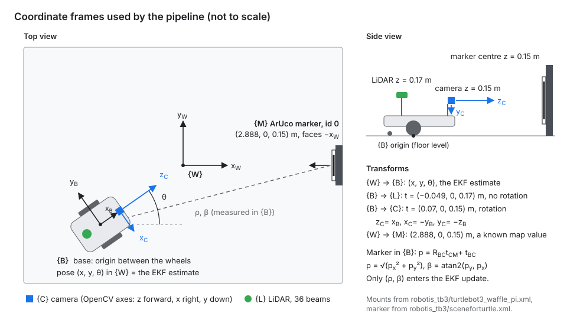

# Part B: Sensing (Dinel)

Part B turns the simulator's exact wheel angles, LiDAR ranges and camera images into realistic sensor measurements, and converts them into the form the estimator and planner use. It supplies the EKF's odometry input `u = [v, omega]`, its camera measurement `z = [range, bearing]` and a measured camera covariance `R`. It also supplies the noisy LiDAR scan. Everything is in `sensing.py`; the pipeline calls it through `part_e_integration/sensor_adapter.py`.

| file in `part_b_sensing/` | what it is |
|---|---|
| `sensing.py` | B1–B7: encoder, LiDAR and camera models, calibration, marker detection, frames, noise experiment |
| `results_part_b/` | `calib.npz` (B4), `camera_R_calibrated.npz` and `camera_R_nominal.npz` (B7), and the result tables quoted below |
| `frames.svg` | the frame diagram: world, robot base, camera, LiDAR and marker, with the transforms between them |
| `markermake.py`, `generatedlidar.py` | small tools used to build the scene: the ArUco marker image and the 36 LiDAR beam lines in the robot xml |
| `simulation_turtlebot.py` | the first sensor demo in the MuJoCo viewer (needs a display; not used by the pipeline) |

## Run and reproduce

From the repository root:

```
python -m part_b_sensing.sensing          self-check: marker range and bearing from one known pose
python -m part_b_sensing.sensing calib    B4: calibrated against true K and reprojection error, saves results_part_b/calib.npz
python -m part_b_sensing.sensing noise    B7: noise tables for both K, saves the two R files (about 3 min)
python -m part_b_sensing.sensing refine   why B5 refines marker corners to sub-pixel accuracy
```

Each command also writes its table to `results_part_b/` (`calibration.md`, `noise.md`, `corner_refinement.md`). B7 uses fixed random seeds, so its tables are repeatable. The pipeline (`main.py`) loads `results_part_b/calib.npz` by default.

## Encoders and odometry (B1)

The simulator reports exact wheel angles. The hardware encoder counts 4096 ticks per revolution, so each angle is rounded to whole ticks and given Gaussian noise:

```
tick = 2*pi / 4096 # 0.00153 rad
angle_meas = round(angle / tick) * tick + N(0, tick^2)
```

The noise standard deviation is one tick. Rounding alone gives up to half a tick of error, and the extra noise stands in for gear backlash and small slip of a similar size. This is a modelling choice tied to the sensor's resolution.

At 50 Hz, odometry differences two readings and calls Part A's `wheels_to_body()`:

```
w_left  = (angle_left_now  - angle_left_prev)  / dt
w_right = (angle_right_now - angle_right_prev) / dt
v, omega = wheels_to_body(w_left, w_right) # u for the EKF predict step
```

Differencing over dt = 0.02 s multiplies angle noise by 50, giving about 2.6 mm/s on v (about 1% of the 0.26 m/s top speed) and 0.018 rad/s on omega. This random noise is small. The larger odometry errors are systematic: even with the floor-contact correction the robot travels and turns up to about 1% less than its encoders say (Part A's model check, `part_a_modelling/results_part_a/validation.md`). Those are what Part C's Q has to cover.

## LiDAR (B2)

The LDS-01 datasheet quotes ±15 mm for 0.12–0.5 m and ±5% for 0.5–3.5 m. We read "±" as a 2σ bound (about 95% of readings):

```
sigma = 7.5 mm          if range < 0.5 m
sigma = 0.025 * range   otherwise
```

Each beam gets independent Gaussian noise, readings are clipped to the rated 0.12–3.5 m, and beams with no return (−1) are set to 3.5 m so the planner treats them as free space. The step in σ at 0.5 m (7.5 to 12.5 mm) comes from the datasheet itself.

## Camera model and calibration (B3, B4)

The rendered camera is a 640 × 480 pinhole with a 60° vertical field of view:

```
f = (480/2) / tan(60deg/2) = 415.69 px
K = [[f, 0, 320], [0, f, 240], [0, 0, 1]]
```

We checked this against the scene: fovy 60°, image 640 × 480, and the camera 0.07 m ahead of the base origin.

The project scene has no calibration target, so `calib_scene.xml` adds an 8 × 6 chessboard of 0.1 m squares (7 × 5 inner corners) to the same robot and camera. K belongs to the camera, so the result applies to the project scene. The robot was placed at 27 poses (3 distances × 3 sideways offsets × 3 headings) and `cv2.calibrateCamera` was run on the detected corners.

| Parameter | True K (B3) | Calibrated (B4) | Difference |
|---|---|---|---|
| fx | 415.69 | 415.79 | +0.09 px (0.02%) |
| fy | 415.69 | 415.77 | +0.08 px (0.02%) |
| cx | 320.00 | 319.61 | −0.39 px |
| cy | 240.00 | 239.34 | −0.66 px |

All 27 photos were used, with 0.097 px reprojection error and almost no distortion (every coefficient under 0.003). The focal length confirms the B3 formula. B3 put the image centre at 320, but because pixels are measured at their centres the true middle is 319.5. Calibration found this half-pixel offset, and B7 shows it was causing a bearing bias.

The camera can only translate and yaw, never tilt, so the views are less varied than a hand-held calibration. That is enough here only because the simulated camera has no distortion to estimate.

## Marker pose, frames and range/bearing (B5, B6)

`detect_marker()` finds ArUco DICT_4X4_50 id 0, refines its corners to sub-pixel accuracy, and solves its pose with `solvePnP(SOLVEPNP_IPPE_SQUARE)`. The result is the marker centre in the OpenCV camera frame (x right, y down, z forward). `cam_to_base()` rotates it into the base frame and adds the camera mount, and `range_bearing()` reduces it to the floor plane:

```
p_base = R_BC @ p_cam + t_cam
R_BC = [[0, 0, 1], [-1, 0, 0], [0, -1, 0]]    # cam z -> base x, cam x -> base -y, cam y -> base -z
t_cam = [0.07, 0, 0.15] m                      # camera mount in turtlebot3_waffle_pi.xml
range = sqrt(x_b^2 + y_b^2); bearing = atan2(y_b, x_b)
```



The full chain is marker → OpenCV camera → base → world, where the last step is the EKF's pose estimate. The marker size in `solvePnP` is the 0.16 m black square, not the 0.2 m plate, because the marker image has a white border (see "Problems found and fixed"). The adapter in Part E checks that these constants match the scene when the pipeline starts.

A detection is rejected and counted in `REJECTS` if:

| Check | Threshold | Reason |
|---|---|---|
| Wrong id | not 0 | only the dock marker is a landmark |
| Too small | shortest side < 30 px | small markers give unreliable poses |
| Bad pose | PnP failed, behind the camera, non-finite, or > 3.5 m | impossible poses |

The 30 px threshold limits camera fixes to about `f * 0.16 / 30 = 2.2 m`. The non-finite check was added after B7 found 10 of 150 frames at 1.5 m returning nan poses (before sub-pixel refinement; none since).

## Measured camera noise and R (B7)

The EKF uses R to decide how much weight to give each camera measurement. If R is too small it chases the noise; if R is too large it ignores good measurements. B7 measures R rather than guessing it.

The robot was parked facing the marker at 1.0, 1.5 and 2.0 m with 150 photos at each distance. Each photo went through `detect_marker()`, `cam_to_base()` and `range_bearing()`. Because we placed the robot, the true range and bearing are known:

```math
e = z_{meas} - z_{true}, \qquad \text{bias} = \bar{e}, \qquad \sigma = \mathrm{std}(e)
```

The simulator is perfectly repeatable, so we added pixel noise (σ = 2 grey levels) and pose jitter (σ = 2 mm, 0.2°). Those assumptions fix the size of σ but not the trends below. The experiment was run with the ideal K (B3) and the calibrated K (B4). This is `measure_noise()` in `sensing.py`.

Ideal K (B3):

| Distance | Seen | Range bias | Range σ | Bearing bias | Bearing σ |
|---|---|---|---|---|---|
| 1.0 m | 150/150 | −0.1 mm | 0.2 mm | 0.068° | 0.013° |
| 1.5 m | 150/150 | 4.3 mm | 2.9 mm | 0.066° | 0.006° |
| 2.0 m | 150/150 | 9.9 mm | 6.7 mm | 0.066° | 0.003° |

Calibrated K (B4):

| Distance | Seen | Range bias | Range σ | Bearing bias | Bearing σ |
|---|---|---|---|---|---|
| 1.0 m | 150/150 | 0.1 mm | 0.2 mm | 0.016° | 0.014° |
| 1.5 m | 150/150 | 4.6 mm | 2.9 mm | 0.015° | 0.006° |
| 2.0 m | 150/150 | 10.4 mm | 6.7 mm | 0.015° | 0.003° |

Results can vary by a fraction of a millimetre between machines because of rendering differences; the trends are unchanged.

**Range noise grows quickly with distance.** Distance comes from how big the marker looks, d = f s / w, so a corner wobble of σ_w pixels gives

```math
\sigma_d = \frac{\sigma_w}{f\,s}\,d^2
```

The spread goes from 0.2 mm at 1 m to 6.7 mm at 2 m: the marker shrinks from about 66 px to 33 px wide, and the pixel noise moves its refined corners proportionally more. The detector is precise; the geometry makes range worse with distance.

**Bearing is far more accurate than range.** At 2 m the bearing σ (0.003°) is about 0.1 mm sideways, against 6.7 mm in range. The camera is excellent at giving the direction and much weaker at giving the distance.

**Range is still biased long**, by up to 10 mm at 2 m, with either K, so K is not the cause. It is what is left of the corner bias that sub-pixel refinement removes most of (next section). A range-dependent bias correction would remove it; we folded it into R instead.

**Calibration removed the bearing bias.** A half-pixel error at the image centre gives 0.5/415.69 rad = 0.069°, which is the bias with the ideal K. With the calibrated K it is 0.015° (about 75% less). σ is the same in both tables because calibration removes the systematic error, not the random noise.

### R for the EKF

`ekf.py` takes one fixed R, so we used the worst case (2 m) and treated the bias as extra variance, because the EKF does not remove it:

```math
R = \mathrm{diag}\left(b_\rho^2 + \sigma_\rho^2,\; b_\beta^2 + \sigma_\beta^2\right)
```

| File in `results_part_b/` | Use with | σ range | σ bearing |
|---|---|---|---|
| `camera_R_nominal.npz` | `--nominal-camera` (ideal K) | 12.0 mm | 0.069° |
| `camera_R_calibrated.npz` | the default, calibrated K | 12.3 mm | 0.021° |

Each R only goes with the K it was measured with. A worst-case R is safe but cautious: at 1 m the real range error is under 1 mm, but R uses 12.3 mm, so the EKF under-trusts the camera when it is closest to the dock.

## Use in the pipeline

The pipeline (`main.py`) uses Part B's functions for every sensor and the calibrated K by default (`--nominal-camera` switches to the ideal K). Part C compared this measured R with its own design R (3 cm, 1°) on identical sensor logs. On nominal runs the measured R gave the same accuracy, a NEES closer to its ideal, and an innovation gate that rejected all ten readings more than 3 cm wrong (32 of 34 on fresh seeds) without losing a good one. Under the disturbances of Part E's robustness study, its tight gate sometimes locked the camera out after a bad first reading, so the pipeline keeps Part C's design R (`PART_C_ESTIMATION.md`). The measured R can be loaded in any run:

```
python main.py --measurement-noise part_b_sensing/results_part_b/camera_R_calibrated.npz
```

## Problems found and fixed

- **Range 25% too long.** The first range read 2.46 m against a true 1.89 m. Two things were wrong: the marker size and the camera mount. Measuring `aruco_0.png` showed the black square is 200 of its 250 pixels, so the detected marker is 0.16 m, not 0.2 m; and the camera sits at x = 0.07 m, not the 0.086 m in our first robot file. `MARKER_SIZE` and `CAM_POS_IN_BASE` now hold the scene's values.
- **Range biased long by up to 8.5 cm.** Even with the right size, the first B7 run measured range biases of 4, 10 and 34 mm at 1, 1.5 and 2 m, and its range spread was 4–19 mm. Without corner refinement, ArUco corners snap to whole pixels, so the marker can look up to about 1.5 px smaller than it is. `python -m part_b_sensing.sensing refine` measures it with the robot head-on and no noise:

  | Distance | No refinement | Sub-pixel refinement |
  |---|---|---|
  | 1.0 m | +6.8 mm | +0.1 mm |
  | 1.5 m | +48.0 mm | +9.7 mm |
  | 1.888 m | +82.3 mm | +16.7 mm |
  | 2.0 m | +85.5 mm | +19.0 mm |

  The error jumped around with distance, depending on how the corners fell on the pixel grid. With `CORNER_REFINE_SUBPIX` it is small and smooth, and B7's worst range bias fell from 34 mm to 10 mm and its spread from 19 mm to 7 mm. The measured R went from 38.5 mm to 12.3 mm in range. Part D's test bench had already found the same fix for its own camera reading.
- **Calibration failing.** Calibration first used only 1 of 27 photos because MuJoCo drew the LiDAR rays across the chessboard. Making the rays transparent in `calib_scene.xml` fixed it.

## Limits

- The encoder σ and the "± = 2σ" reading of the LiDAR datasheet are modelling choices.
- B7 only tests head-on views at 1 to 2 m; angled views and docking distances below 1 m were not measured. Part C's tuning runs show what that misses: of 2438 camera readings, the ten that were more than 3 cm wrong (5–11 cm short) were all seen 10–23° off the camera axis.
- Pixel noise and pose jitter in B7 are assumed values.
- The scene draws LiDAR rays into camera images, which a real camera would not see.
- One fixed R is a compromise. A range-dependent R (σ_ρ growing with d²) and subtracting the range bias would be better.

Ground truth is never used in any of Part B's in-loop functions. `noisy_encoders`, `odometry`, `noisy_lidar`, `detect_marker`, `cam_to_base` and `range_bearing` use only sensor data (`part_e_integration/test_pipeline.py` checks this). B4 and B7 are offline experiments that place the robot themselves and compare against those known poses. They are not part of the closed loop.

## Generative AI

Claude (Anthropic) was used to help design, write (this page), debug, and test this part, and in the final consistency pass (sub-pixel corner refinement, the refinement check, folder structure and re-running B4 and B7).
