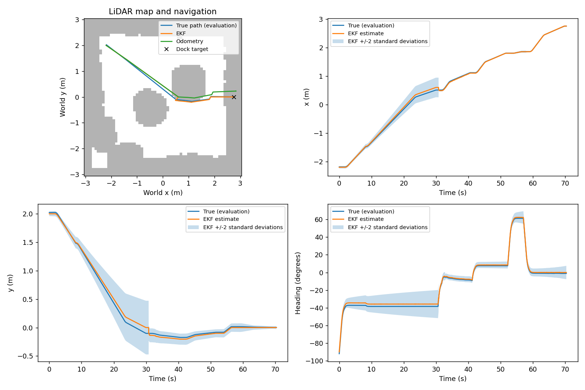

# Part C: Track A pose estimation

The estimator fuses wheel-encoder odometry with camera range and bearing to the
known docking marker. The LQR and LiDAR planner receive its estimated pose.
The simulator's live pose is used only in evaluation. This implements Track A's
EKF requirement and supplies design, tuning and quantitative performance evidence
for criterion C in the supplied marking guide.

## Run and reproduce

From the repository root, install `requirements.txt`, then run:

```powershell
python -B -m unittest discover -s part_c_estimation -p "test_*.py" -v
python main.py

# Tuning set: nine rendered-camera closed-loop trials and paired replay comparisons.
python part_c_estimation/evaluate_estimator.py --collect

# Independent validation seeds; settings remain Q x1 and R x1.
python part_c_estimation/evaluate_estimator.py --collect --seed 2000 --output part_c_estimation/results_part_c/validation

# Recompute tuning metrics and figures from existing sensor logs.
python part_c_estimation/evaluate_estimator.py

# Change noise settings in the actual closed loop, not only offline replay.
python main.py --q-scale 0.1 --r-scale 1 --output part_e_integration/results_pipeline/q01
```

Collection requires a fresh output directory to prevent mixing experiments.
To repeat collection, choose another `--output`; omit `--collect` to replay an
existing set. Compact CSVs, generated result tables and figures are kept in
`results_part_c/`. Raw sensor logs are in its ignored `logs/` subdirectories and
are regenerated by the commands above. Include the compact results in the
submitted repository and link this report from the project page.

## State, prediction and camera update

The state is `[world x, world y, heading]` in metres/metres/radians. The world
frame is the fixed room frame used by the known marker map; it is not reset at
each starting location. The filter starts at the intended placement, with
standard deviations `[0.02 m, 0.02 m, 1.5 degrees]`. Random placement trials
perturb the actual robot without telling the filter that perturbation.

At 50 Hz, Part B differences noisy wheel angles and calls Part A's wheel-to-body
conversion to produce `[v, omega]`. The EKF uses Part A's nonlinear motion model
and its state Jacobian F:

```text
x_pred = f(x, [v, omega], dt)
P_pred = F P F' + Q * dt / 0.02
```

The additive Q is a residual motion-model uncertainty floor at 20 ms, treated as
diffusion when dt changes. It covers effects omitted by the kinematic model;
it is not a measurement of encoder noise. This approximation does not model
correlated slip or the temporal correlation from differencing noisy encoders.

At up to 10 Hz, Part B detects the marker in a rendered RGB image, estimates its
translation and transforms it to the base frame. The adapter accounts for the
current marker's 0.16 m black square and camera translation `[0.07, 0, 0.15] m`.
Only the resulting planar range/bearing enters the EKF:

```text
dx = marker_x - x; dy = marker_y - y
h(x) = [sqrt(dx*dx + dy*dy), atan2(dy, dx) - heading]
innovation = z - h(x)                         # wrap bearing to [-pi, pi)
S = H P H' + R
NIS = innovation' solve(S, innovation)
K = solve(S, H P)'
x_updated = x + K innovation                 # wrap heading
P_updated = (I-KH) P (I-KH)' + K R K'         # Joseph covariance update
```

H is the analytic derivative of h. Linear solves replace explicit matrix inverses. The Joseph
form and symmetry cleanup reduce numerical loss of covariance positivity.

Measurements with invalid shape, non-finite values or nonpositive range are
rejected. Bearing is undefined at the landmark itself. A two-value
innovation is rejected when NIS exceeds **9.21**, the approximate 99% chi-square
threshold for two degrees of freedom under the ideal Gaussian model. When no
marker is detected, the filter simply continues predicting from wheel odometry.

One function-based API (`predict`, `update`, `nees`) serves both runners.
The pipeline passes its Q/R matrices explicitly. Trials run sequentially and
reset the shared update counters before each run.

## Noise settings and the tuning decision

At the reference 20 ms prediction interval:

| Matrix | Diagonal entries | Interpretation |
|---|---|---|
| Q | `1e-6, 1e-6, 1.21846968e-5` | 1 mm x/y and 0.2 degree heading standard deviation per reference prediction |
| R | `9e-4, 3.04617420e-4` | 3 cm range and 1 degree bearing standard deviation per camera reading |

Off-diagonal zeros are a simplifying independence assumption. These remain
**simulation design values, not sensor calibration results**. They were retained
after the following comparative tuning study; Part B's measured covariance can
replace R without changing the estimator.

Three scenarios each use three independent placement/noise seeds: west
1000-1002, north 1100-1102, and south 1200-1202 with the left motor at 90% and
camera unavailable from 25 to 30 s. All nine rendered-camera closed-loop trials
completed with zero recorded collisions. Their recorded odometry and camera
measurements are replayed through each noise variant, giving identical inputs
for a fair estimator comparison. Baseline replay is checked against every saved
live estimate, covariance and gate decision.

| Variant | Mean position RMSE (cm) | Mean NEES | x +/-2-sigma coverage | Mean camera rejects/trial |
|---|---|---|---|---|
| **Retained Q x1, R x1** | **3.77** | **2.23** | **88.2%** | **1.22** |
| Q x0.1 | 3.66 | 6.32 | 72.6% | 1.22 |
| Q x10 | 3.97 | 0.72 | 99.2% | 1.11 |
| R x0.1 | 3.90 | 6.70 | 81.4% | 5.67 |
| R x10 | 3.70 | 0.82 | 99.5% | 0.00 |
| Encoder odometry only | 9.84 | 0.43 | 100% | 0 |

Reducing Q tenfold saves only 0.11 cm of mean position error while increasing
NEES and reducing x coverage substantially: the filter is more confident than
its errors justify. Increasing Q makes uncertainty much larger with slightly
worse accuracy. Reducing R tenfold increases rejection of camera updates and
worsens both accuracy and NEES. Increasing R tenfold slightly reduces error but
makes the filter substantially more conservative. The baseline is retained as
a compromise, rather than choosing the lowest RMSE alone. This is a small
study, not evidence that these settings are globally optimal.

The baseline is **not fully statistically consistent**: y and heading coverage
are both 100%, x coverage is 88.2%, and mean pre-gate NIS is only 0.159 instead
of the ideal value 2. A mean NEES near 3 does not fix that mismatch. The rendered
camera is largely deterministic, residual range bias is distance dependent, and
the process model is approximate. Part B calibration and bias/noise experiments
are still necessary; there is no evidence here of a calibrated stochastic camera.
See [full tuning results](results_part_c/results.md) and per-trial CSVs.

## Independent validation and robustness

After retaining the baseline, a second set uses fresh seeds with no parameter
changes: west 2000-2002, north 2100-2102, disturbed south 2200-2202.

| Scenario | Successful docks | Recorded collisions | Mean EKF position RMSE | Mean odometry position RMSE |
|---|---|---|---|---|
| West | 3/3 | 0 | 2.99 cm | 6.51 cm |
| North | 3/3 | 0 | 4.74 cm | 13.33 cm |
| South: weak motor and five-second camera loss | 3/3 | 0 | 3.70 cm | 8.82 cm |

Across validation, the mean of per-trial position RMSE is **3.81 cm** for the
EKF and **9.55 cm** for odometry alone, approximately a **60% reduction**.
All nine runs succeed; maximum final absolute errors are 0.39 cm along,
0.22 cm sideways and 1.33 degrees. Together with tuning collection, this is
18/18 successful selected trials, not a general success-rate guarantee.

The disturbed south trials provide live evidence of prediction through
camera dropout. The innovation gate rejects measurements with excessive NIS.



The worst tuning trial shows odometry drift before the first marker fix at about
31 s. The first corrections reduce uncertainty sharply, but biased camera range
temporarily gives a high NEES. This explains why successful final docking alone
does not establish accurate or consistent estimation throughout a route.

## Evaluation, observability and limits

Full 3x3 covariance is saved, including cross terms. NEES is
`error' solve(P, error)` with wrapped heading error. Per-state coverage is the
fraction of samples inside the plotted +/-2 standard deviations. NIS is logged
before gating, so rejected readings remain visible. Means weight each trajectory
equally. Consecutive time samples are correlated; these are descriptive checks,
not independent-sample confidence intervals or a proof of consistency.

One point landmark supplying only range/bearing has a rotational ambiguity:
rotating the whole trajectory around that landmark and adjusting heading can
preserve the measurements. Odometry and a known placement prior let this local
filter work, but they do not make all global pose directions observable. A second
known landmark or use of marker orientation/full pose could resolve that mode.
During marker loss there is no absolute correction and uncertainty generally
grows. Large initial pose errors, strong slip, biased measurements and a long
dropout can exceed the local EKF's operating range or its innovation gate.

Ground truth is never a live input to `predict`, `update`, `Pipeline.step`, the planner or
the controller. Evaluation reads truth after commands have been computed.
Replay reads truth only in its final scoring function. The retained MuJoCo
leak-check test verifies that hiding evaluation truth does not change commands.

## Part B handoff

Once Part B supplies genuine measurement-error results, export a positive
definite 2x2 covariance as `np.savez("camera_noise.npz", R=R_measured)` in
`[range metres, bearing radians]` order. Units of the diagonal are m^2 and rad^2;
cross terms have m*rad units. Report and address systematic bias separately.
Do not use degrees squared or an unexplained numerical floor for zero variance.

```powershell
python main.py --calibration path/to/calib.npz --measurement-noise path/to/camera_noise.npz
python part_c_estimation/evaluate_estimator.py --collect --calibration path/to/calib.npz --measurement-noise path/to/camera_noise.npz --output part_c_estimation/results_part_c/after_calibration
```

K/dist intrinsics and R describe different things, so they are loaded separately.
The loader checks matrix shape, finiteness, symmetry and positive definiteness.
Repeat the tuning and fresh-seed validation after changing the detector,
intrinsics, frame conversion or noise model. Part B still needs calibration,
consistent frame/marker settings, detector bias correction and measured noise.

OpenAI Codex assisted with the Part C implementation, tests, evaluation tooling,
experiment execution and documentation. Include those tools and purposes in the
team's project-page AI declaration, and review these choices for the viva.
