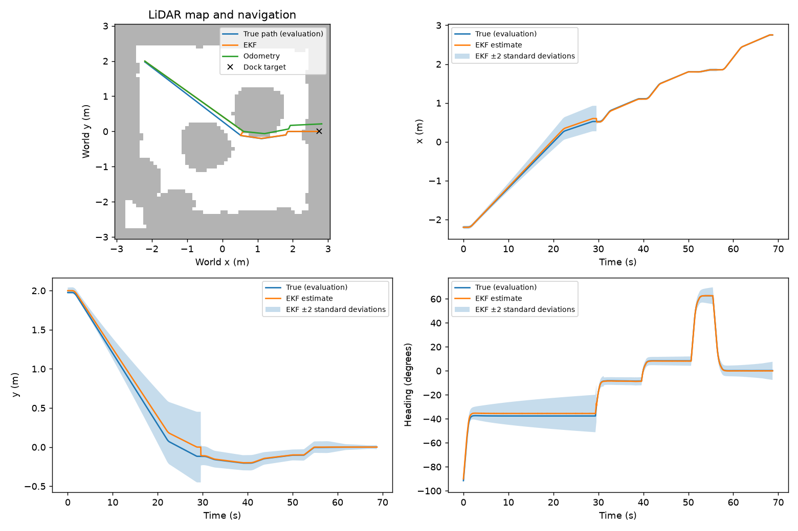

# Part C experiment results

Replay of 9 rendered-camera trajectories; each trial has equal weight. The trials were driven live with Part C's design Q and R.
Every variant replays the same recorded inputs with a fixed setting, so these are estimator comparisons, not new closed-loop trials. design = Part C's design Q and R; the next four scale one of them; R_measured is Part B's measured R (camera_R_calibrated.npz), used alone and with Q ×0.1: σ range 12.3 mm, σ bearing 0.021°.

| Variant | Mean position RMSE (cm) | Heading RMSE (deg) | Mean NEES | x/y/heading coverage (%) | Mean pre-gate NIS | Rejects/trial |
|---|---|---|---|---|---|---|
| design | 3.71 | 1.19 | 0.668 | 100.0/100.0/100.0 | 0.032 | 0.33 |
| Q_x0.1 | 3.64 | 1.14 | 1.757 | 95.8/100.0/100.0 | 0.042 | 0.33 |
| Q_x10 | 3.74 | 1.20 | 0.185 | 100.0/100.0/100.0 | 0.026 | 0.22 |
| R_x0.1 | 3.71 | 1.19 | 1.406 | 97.8/100.0/100.0 | 0.242 | 1.11 |
| R_x10 | 3.71 | 1.19 | 0.424 | 100.0/100.0/100.0 | 0.005 | 0.00 |
| R_measured | 3.71 | 1.19 | 1.453 | 98.5/100.0/100.0 | 0.158 | 1.11 |
| Q_x0.1_R_measured | 3.62 | 1.13 | 3.628 | 85.5/100.0/100.0 | 0.253 | 1.11 |
| odometry_only | 9.80 | 1.74 | 0.424 | 100.0/100.0/100.0 | n/a | 0.00 |

Coverage is the fraction inside ±2 standard deviations. Ideal mean NEES is 3 and NIS is 2.
NIS includes rejected measurements. Time samples are correlated; these are descriptive consistency checks.

Per scenario: mean position RMSE in cm, with mean NEES in brackets.

| Scenario | Trials | design | Q_x0.1 | Q_x10 | R_x0.1 | R_x10 | R_measured | Q_x0.1_R_measured | odometry_only |
|---|---|---|---|---|---|---|---|---|---|
| north | 3 | 5.09 (0.79) | 5.00 (2.18) | 5.11 (0.21) | 5.08 (1.66) | 5.10 (0.51) | 5.07 (1.61) | 4.94 (4.25) | 12.67 (0.50) |
| south_disturbed | 3 | 2.45 (0.57) | 2.38 (1.35) | 2.49 (0.16) | 2.46 (1.11) | 2.43 (0.38) | 2.45 (1.30) | 2.37 (2.90) | 6.21 (0.38) |
| west | 3 | 3.60 (0.64) | 3.55 (1.74) | 3.63 (0.19) | 3.61 (1.45) | 3.61 (0.38) | 3.61 (1.45) | 3.55 (3.73) | 10.53 (0.40) |

What the innovation gate (NIS > 9.21) did with the camera readings. A reading is bad when its range is more than 3 cm from the truth (scored afterwards, never used live). The bad readings were seen 10–23° off the camera axis.

| Variant | Readings | Bad readings | Bad ones rejected | Good ones rejected |
|---|---|---|---|---|
| design | 2438 | 10 | 3 | 0 |
| Q_x0.1 | 2438 | 10 | 3 | 0 |
| Q_x10 | 2438 | 10 | 2 | 0 |
| R_x0.1 | 2438 | 10 | 10 | 0 |
| R_x10 | 2438 | 10 | 0 | 0 |
| R_measured | 2438 | 10 | 10 | 0 |
| Q_x0.1_R_measured | 2438 | 10 | 10 | 0 |

