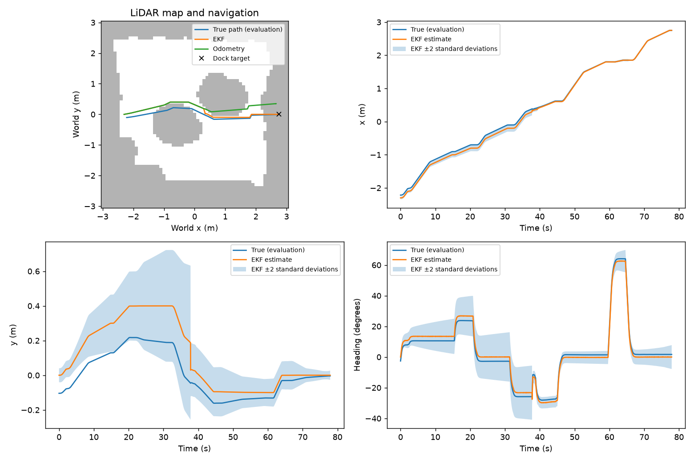

# Part C experiment results

Replay of 57 rendered-camera trajectories; each trial has equal weight. The trials were driven live with Part C's design Q and R.
Every variant replays the same recorded inputs with a fixed setting, so these are estimator comparisons, not new closed-loop trials. design = Part C's design Q and R; the next four scale one of them; R_measured is Part B's measured R (camera_R_calibrated.npz), used alone and with Q ×0.1: σ range 12.3 mm, σ bearing 0.021°.

| Variant | Mean position RMSE (cm) | Heading RMSE (deg) | Mean NEES | x/y/heading coverage (%) | Mean pre-gate NIS | Rejects/trial |
|---|---|---|---|---|---|---|
| design | 3.53 | 0.85 | 0.852 | 98.1/99.5/99.9 | 0.094 | 0.96 |
| Q_x0.1 | 3.57 | 0.82 | 2.662 | 88.1/97.0/98.9 | 0.542 | 5.96 |
| Q_x10 | 3.71 | 0.94 | 0.230 | 99.6/99.9/100.0 | 0.073 | 0.72 |
| R_x0.1 | 3.74 | 0.89 | 2.129 | 92.3/99.5/99.8 | 1.775 | 13.04 |
| R_x10 | 3.51 | 0.84 | 0.641 | 98.2/99.5/99.9 | 0.012 | 0.00 |
| R_measured | 3.74 | 0.88 | 2.063 | 93.3/99.5/99.9 | 1.361 | 12.75 |
| Q_x0.1_R_measured | 3.60 | 0.83 | 5.563 | 82.8/96.8/98.3 | 3.391 | 13.16 |
| odometry_only | 6.34 | 1.04 | 0.729 | 97.3/99.5/99.9 | n/a | 0.00 |

Coverage is the fraction inside ±2 standard deviations. Ideal mean NEES is 3 and NIS is 2.
NIS includes rejected measurements. Time samples are correlated; these are descriptive consistency checks.

Per scenario: mean position RMSE in cm, with mean NEES in brackets.

| Scenario | Trials | design | Q_x0.1 | Q_x10 | R_x0.1 | R_x10 | R_measured | Q_x0.1_R_measured | odometry_only |
|---|---|---|---|---|---|---|---|---|---|
| camera_loss_10s | 3 | 2.62 (0.47) | 2.62 (1.35) | 2.59 (0.13) | 2.59 (1.12) | 2.64 (0.25) | 2.58 (1.13) | 2.55 (2.96) | 4.16 (0.21) |
| camera_loss_20s | 3 | 3.13 (0.20) | 3.12 (0.53) | 3.15 (0.05) | 3.14 (0.22) | 3.13 (0.19) | 3.14 (0.44) | 3.13 (0.84) | 4.68 (0.21) |
| camera_loss_30s | 3 | 3.81 (0.21) | 3.81 (0.60) | 3.82 (0.04) | 3.82 (0.22) | 3.81 (0.21) | 3.82 (0.32) | 3.81 (0.74) | 4.68 (0.22) |
| camera_loss_40s | 3 | 4.66 (0.22) | 4.66 (0.65) | 4.66 (0.04) | 4.66 (0.22) | 4.66 (0.22) | 4.66 (0.22) | 4.66 (0.65) | 4.66 (0.22) |
| camera_loss_rest | 3 | 4.66 (0.22) | 4.66 (0.65) | 4.66 (0.04) | 4.66 (0.22) | 4.66 (0.22) | 4.66 (0.22) | 4.66 (0.65) | 4.66 (0.22) |
| encoder_noise_x10 | 3 | 2.52 (0.63) | 2.41 (1.70) | 2.58 (0.18) | 2.56 (1.69) | 2.47 (0.28) | 2.56 (1.70) | 2.44 (5.65) | 4.87 (0.23) |
| encoder_noise_x30 | 3 | 2.86 (0.90) | 2.68 (2.51) | 3.33 (0.28) | 2.97 (2.48) | 2.73 (0.38) | 3.01 (3.28) | 2.88 (14.30) | 5.55 (0.26) |
| lidar_noise_x10 | 3 | 1.60 (0.15) | 1.60 (0.55) | 1.60 (0.03) | 1.60 (0.15) | 1.60 (0.15) | 1.60 (0.15) | 1.60 (0.55) | 1.60 (0.15) |
| lidar_noise_x30 | 3 | 1.59 (0.14) | 1.59 (0.51) | 1.59 (0.02) | 1.59 (0.14) | 1.59 (0.14) | 1.59 (0.14) | 1.59 (0.51) | 1.59 (0.14) |
| lidar_noise_x3 | 3 | 2.56 (0.35) | 2.56 (0.94) | 2.55 (0.10) | 2.55 (0.80) | 2.56 (0.20) | 2.56 (0.88) | 2.56 (2.19) | 4.98 (0.19) |
| motor_0.5 | 3 | 2.18 (0.66) | 2.12 (1.91) | 2.21 (0.21) | 2.21 (1.79) | 2.14 (0.28) | 2.21 (1.62) | 2.13 (4.47) | 3.66 (0.21) |
| motor_0.6 | 3 | 2.02 (0.66) | 1.95 (1.86) | 2.04 (0.20) | 2.03 (1.82) | 1.97 (0.27) | 2.03 (1.63) | 1.96 (4.51) | 3.65 (0.20) |
| motor_0.7 | 3 | 2.16 (0.73) | 2.07 (1.71) | 3.09 (0.31) | 3.19 (5.20) | 2.06 (0.26) | 3.16 (4.30) | 2.06 (4.17) | 3.98 (0.21) |
| motor_0.8 | 3 | 2.20 (0.69) | 2.13 (1.71) | 3.77 (0.33) | 4.43 (10.60) | 2.17 (0.26) | 4.35 (9.23) | 2.16 (4.30) | 4.30 (0.22) |
| nominal_north | 3 | 2.81 (0.56) | 2.79 (1.53) | 2.84 (0.17) | 2.83 (1.42) | 2.80 (0.27) | 2.83 (1.43) | 2.79 (3.67) | 7.16 (0.24) |
| nominal_south | 3 | 4.69 (0.83) | 4.54 (1.96) | 4.82 (0.20) | 4.76 (1.34) | 4.66 (0.68) | 4.74 (1.53) | 4.56 (3.29) | 15.06 (0.98) |
| nominal_west | 3 | 2.46 (0.55) | 2.36 (1.50) | 2.52 (0.17) | 2.49 (1.47) | 2.41 (0.26) | 2.49 (1.40) | 2.38 (3.71) | 4.63 (0.21) |
| placement_x3 | 3 | 6.30 (1.77) | 6.19 (4.23) | 6.35 (0.42) | 6.32 (2.35) | 6.33 (1.59) | 6.32 (2.38) | 6.23 (5.68) | 12.91 (1.92) |
| placement_x6 | 3 | 12.28 (6.25) | 13.97 (24.18) | 12.36 (1.47) | 12.71 (7.21) | 12.31 (6.06) | 12.69 (7.21) | 14.26 (42.88) | 23.66 (7.62) |

What the innovation gate (NIS > 9.21) did with the camera readings. A reading is bad when its range is more than 3 cm from the truth (scored afterwards, never used live). The bad readings were seen 5–33° off the camera axis.

| Variant | Readings | Bad readings | Bad ones rejected | Good ones rejected |
|---|---|---|---|---|
| design | 13646 | 99 | 55 | 0 |
| Q_x0.1 | 13646 | 99 | 56 | 284 |
| Q_x10 | 13646 | 99 | 41 | 0 |
| R_x0.1 | 13646 | 99 | 88 | 655 |
| R_x10 | 13646 | 99 | 0 | 0 |
| R_measured | 13646 | 99 | 79 | 648 |
| Q_x0.1_R_measured | 13646 | 99 | 91 | 659 |

