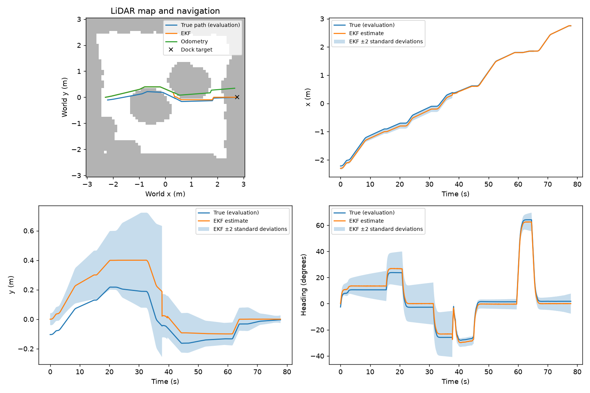

# Part C experiment results

Replay of 57 rendered-camera trajectories; each trial has equal weight. The trials were driven live with Part C's design Q with Part B's measured R.
Every variant replays the same recorded inputs with a fixed setting, so these are estimator comparisons, not new closed-loop trials. design = Part C's design Q and R; the next four scale one of them; R_measured is Part B's measured R (camera_R_calibrated.npz), used alone and with Q ×0.1: σ range 12.3 mm, σ bearing 0.021°.

| Variant | Mean position RMSE (cm) | Heading RMSE (deg) | Mean NEES | x/y/heading coverage (%) | Mean pre-gate NIS | Rejects/trial |
|---|---|---|---|---|---|---|
| design | 3.52 | 0.85 | 0.837 | 98.2/99.5/99.9 | 0.098 | 0.91 |
| Q_x0.1 | 3.53 | 0.81 | 2.467 | 88.4/96.9/98.8 | 0.402 | 6.35 |
| Q_x10 | 3.70 | 0.94 | 0.232 | 99.6/99.9/100.0 | 0.075 | 0.79 |
| R_x0.1 | 3.72 | 0.87 | 1.928 | 92.3/99.5/99.9 | 1.579 | 12.00 |
| R_x10 | 3.50 | 0.84 | 0.624 | 98.3/99.5/99.9 | 0.013 | 0.00 |
| R_measured | 3.64 | 0.87 | 1.712 | 93.9/99.5/99.9 | 0.930 | 8.25 |
| Q_x0.1_R_measured | 3.54 | 0.82 | 4.740 | 82.6/96.8/98.3 | 2.298 | 14.47 |
| odometry_only | 6.38 | 1.06 | 0.713 | 97.3/99.5/99.9 | n/a | 0.00 |

Coverage is the fraction inside ±2 standard deviations. Ideal mean NEES is 3 and NIS is 2.
NIS includes rejected measurements. Time samples are correlated; these are descriptive consistency checks.

Per scenario: mean position RMSE in cm, with mean NEES in brackets.

| Scenario | Trials | design | Q_x0.1 | Q_x10 | R_x0.1 | R_x10 | R_measured | Q_x0.1_R_measured | odometry_only |
|---|---|---|---|---|---|---|---|---|---|
| camera_loss_10s | 3 | 2.63 (0.47) | 2.63 (1.34) | 2.60 (0.13) | 2.60 (1.13) | 2.65 (0.26) | 2.59 (1.14) | 2.56 (2.95) | 4.15 (0.21) |
| camera_loss_20s | 3 | 3.13 (0.20) | 3.12 (0.53) | 3.14 (0.04) | 3.14 (0.22) | 3.13 (0.19) | 3.14 (0.46) | 3.13 (0.87) | 4.67 (0.21) |
| camera_loss_30s | 3 | 3.81 (0.21) | 3.81 (0.59) | 3.82 (0.04) | 3.82 (0.22) | 3.81 (0.21) | 3.82 (0.31) | 3.81 (0.73) | 4.68 (0.22) |
| camera_loss_40s | 3 | 4.66 (0.22) | 4.66 (0.65) | 4.66 (0.04) | 4.66 (0.22) | 4.66 (0.22) | 4.66 (0.22) | 4.66 (0.65) | 4.66 (0.22) |
| camera_loss_rest | 3 | 4.66 (0.22) | 4.66 (0.65) | 4.66 (0.04) | 4.66 (0.22) | 4.66 (0.22) | 4.66 (0.22) | 4.66 (0.65) | 4.66 (0.22) |
| encoder_noise_x10 | 3 | 2.54 (0.66) | 2.43 (1.82) | 2.58 (0.19) | 2.56 (1.72) | 2.50 (0.31) | 2.56 (1.73) | 2.44 (5.77) | 4.88 (0.23) |
| encoder_noise_x30 | 3 | 2.76 (0.89) | 2.61 (2.41) | 2.83 (0.28) | 2.91 (2.54) | 2.70 (0.38) | 2.94 (3.35) | 2.81 (14.46) | 5.61 (0.25) |
| lidar_noise_x10 | 3 | 1.60 (0.15) | 1.60 (0.55) | 1.60 (0.03) | 1.60 (0.15) | 1.60 (0.15) | 1.60 (0.15) | 1.60 (0.55) | 1.60 (0.15) |
| lidar_noise_x30 | 3 | 1.59 (0.14) | 1.59 (0.51) | 1.59 (0.02) | 1.59 (0.14) | 1.59 (0.14) | 1.59 (0.14) | 1.59 (0.51) | 1.59 (0.14) |
| lidar_noise_x3 | 3 | 2.55 (0.36) | 2.55 (0.97) | 2.55 (0.10) | 2.55 (0.84) | 2.56 (0.20) | 2.55 (0.90) | 2.55 (2.27) | 4.98 (0.19) |
| motor_0.5 | 3 | 2.15 (0.63) | 2.08 (1.82) | 2.18 (0.20) | 2.17 (1.70) | 2.10 (0.27) | 2.17 (1.55) | 2.10 (4.26) | 3.70 (0.20) |
| motor_0.6 | 3 | 2.00 (0.66) | 1.94 (1.78) | 2.04 (0.21) | 2.03 (1.86) | 1.98 (0.28) | 2.03 (1.67) | 1.96 (4.61) | 3.66 (0.20) |
| motor_0.7 | 3 | 2.14 (0.66) | 2.04 (1.65) | 2.92 (0.27) | 3.81 (6.11) | 2.05 (0.25) | 2.68 (2.28) | 2.07 (4.06) | 3.96 (0.21) |
| motor_0.8 | 3 | 2.23 (0.75) | 2.15 (1.79) | 4.26 (0.42) | 3.82 (6.00) | 2.19 (0.28) | 3.64 (4.77) | 2.17 (4.31) | 4.34 (0.22) |
| nominal_north | 3 | 2.81 (0.58) | 2.76 (1.51) | 2.85 (0.18) | 2.84 (1.51) | 2.78 (0.26) | 2.83 (1.49) | 2.80 (3.85) | 7.74 (0.23) |
| nominal_south | 3 | 4.69 (0.86) | 4.55 (2.06) | 4.81 (0.20) | 4.76 (1.38) | 4.66 (0.68) | 4.74 (1.54) | 4.56 (3.38) | 15.06 (0.98) |
| nominal_west | 3 | 2.47 (0.58) | 2.36 (1.57) | 2.51 (0.17) | 2.50 (1.50) | 2.43 (0.27) | 2.49 (1.43) | 2.38 (3.77) | 4.66 (0.21) |
| placement_x3 | 3 | 6.31 (1.74) | 6.20 (4.13) | 6.58 (0.43) | 6.33 (2.34) | 6.32 (1.58) | 6.33 (2.39) | 6.26 (5.53) | 12.99 (1.93) |
| placement_x6 | 3 | 12.11 (5.93) | 13.34 (20.54) | 12.21 (1.39) | 12.25 (6.83) | 12.13 (5.71) | 12.16 (6.81) | 13.11 (26.87) | 23.67 (7.31) |

What the innovation gate (NIS > 9.21) did with the camera readings. A reading is bad when its range is more than 3 cm from the truth (scored afterwards, never used live). The bad readings were seen 5–33° off the camera axis.

| Variant | Readings | Bad readings | Bad ones rejected | Good ones rejected |
|---|---|---|---|---|
| design | 13623 | 103 | 52 | 0 |
| Q_x0.1 | 13623 | 103 | 51 | 311 |
| Q_x10 | 13623 | 103 | 45 | 0 |
| R_x0.1 | 13623 | 103 | 97 | 587 |
| R_x10 | 13623 | 103 | 0 | 0 |
| R_measured | 13623 | 103 | 96 | 374 |
| Q_x0.1_R_measured | 13623 | 103 | 100 | 725 |

