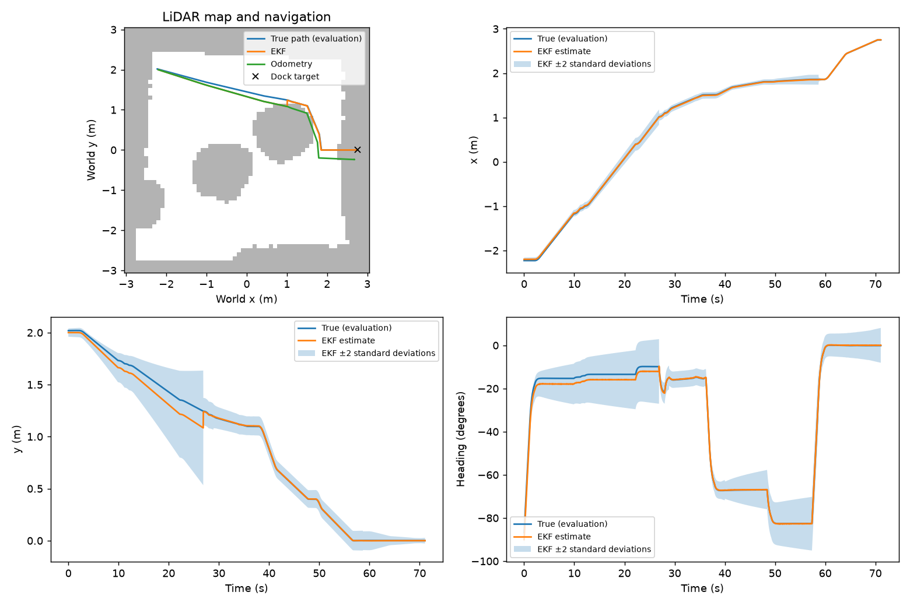

# Part C experiment results

Replay of 9 rendered-camera trajectories; each trial has equal weight. The trials were driven live with Part C's design Q and R.
Every variant replays the same recorded inputs with a fixed setting, so these are estimator comparisons, not new closed-loop trials. design = Part C's design Q and R; the next four scale one of them; R_measured is Part B's measured R (camera_R_calibrated.npz), used alone and with Q ×0.1: σ range 12.3 mm, σ bearing 0.021°.

| Variant | Mean position RMSE (cm) | Heading RMSE (deg) | Mean NEES | x/y/heading coverage (%) | Mean pre-gate NIS | Rejects/trial |
|---|---|---|---|---|---|---|
| design | 3.60 | 1.13 | 0.937 | 100.0/99.6/99.8 | 0.086 | 1.11 |
| Q_x0.1 | 3.53 | 1.07 | 2.266 | 93.7/97.4/98.2 | 0.105 | 1.11 |
| Q_x10 | 3.65 | 1.16 | 0.259 | 100.0/100.0/100.0 | 0.067 | 0.78 |
| R_x0.1 | 3.61 | 1.14 | 1.741 | 97.4/99.6/99.8 | 0.664 | 2.33 |
| R_x10 | 3.60 | 1.13 | 0.678 | 100.0/99.6/99.8 | 0.012 | 0.00 |
| R_measured | 3.61 | 1.14 | 1.776 | 98.0/99.6/99.8 | 0.423 | 2.11 |
| Q_x0.1_R_measured | 3.53 | 1.07 | 4.302 | 88.2/97.4/98.2 | 0.574 | 2.33 |
| odometry_only | 9.53 | 1.64 | 0.837 | 100.0/99.6/99.8 | n/a | 0.00 |

Coverage is the fraction inside ±2 standard deviations. Ideal mean NEES is 3 and NIS is 2.
NIS includes rejected measurements. Time samples are correlated; these are descriptive consistency checks.

Per scenario: mean position RMSE in cm, with mean NEES in brackets.

| Scenario | Trials | design | Q_x0.1 | Q_x10 | R_x0.1 | R_x10 | R_measured | Q_x0.1_R_measured | odometry_only |
|---|---|---|---|---|---|---|---|---|---|
| north | 3 | 4.66 (0.93) | 4.60 (2.37) | 4.68 (0.26) | 4.68 (1.81) | 4.69 (0.68) | 4.67 (1.80) | 4.60 (4.52) | 13.30 (0.82) |
| south_disturbed | 3 | 3.47 (1.10) | 3.34 (2.28) | 3.56 (0.29) | 3.48 (1.61) | 3.45 (0.93) | 3.48 (1.80) | 3.35 (3.77) | 8.80 (1.31) |
| west | 3 | 2.67 (0.77) | 2.65 (2.15) | 2.70 (0.23) | 2.68 (1.80) | 2.66 (0.43) | 2.68 (1.73) | 2.65 (4.61) | 6.48 (0.38) |

What the innovation gate (NIS > 9.21) did with the camera readings. A reading is bad when its range is more than 3 cm from the truth (scored afterwards, never used live). The bad readings were seen 10–29° off the camera axis.

| Variant | Readings | Bad readings | Bad ones rejected | Good ones rejected |
|---|---|---|---|---|
| design | 2399 | 21 | 10 | 0 |
| Q_x0.1 | 2399 | 21 | 10 | 0 |
| Q_x10 | 2399 | 21 | 7 | 0 |
| R_x0.1 | 2399 | 21 | 21 | 0 |
| R_x10 | 2399 | 21 | 0 | 0 |
| R_measured | 2399 | 21 | 19 | 0 |
| Q_x0.1_R_measured | 2399 | 21 | 21 | 0 |

