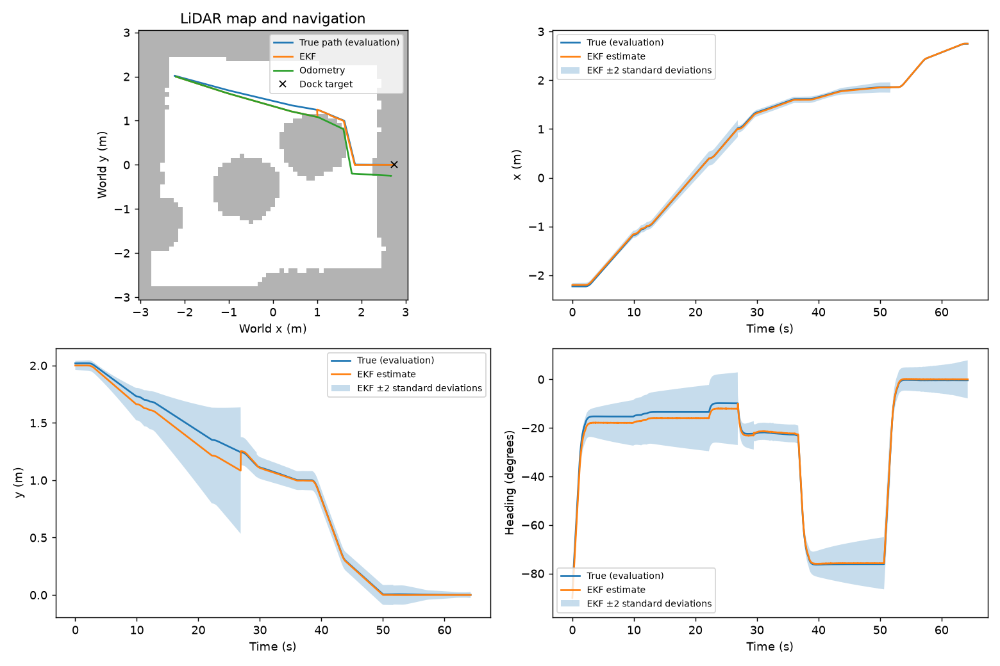

# Part C experiment results

Replay of 9 rendered-camera trajectories; each trial has equal weight. The trials were driven live with Part C's design Q with Part B's measured R.
Every variant replays the same recorded inputs with a fixed setting, so these are estimator comparisons, not new closed-loop trials. design = Part C's design Q and R; the next four scale one of them; R_measured is Part B's measured R (camera_R_calibrated.npz), used alone and with Q ×0.1: σ range 12.3 mm, σ bearing 0.021°.

| Variant | Mean position RMSE (cm) | Heading RMSE (deg) | Mean NEES | x/y/heading coverage (%) | Mean pre-gate NIS | Rejects/trial |
|---|---|---|---|---|---|---|
| design | 3.64 | 1.14 | 0.949 | 99.8/99.6/99.8 | 0.117 | 1.44 |
| Q_x0.1 | 3.56 | 1.08 | 2.234 | 93.7/97.4/98.2 | 0.138 | 1.67 |
| Q_x10 | 3.68 | 1.17 | 0.267 | 99.9/100.0/100.0 | 0.093 | 1.33 |
| R_x0.1 | 3.64 | 1.14 | 1.710 | 97.4/99.6/99.8 | 0.934 | 3.78 |
| R_x10 | 3.63 | 1.14 | 0.681 | 100.0/99.6/99.8 | 0.015 | 0.00 |
| R_measured | 3.64 | 1.14 | 1.738 | 97.8/99.6/99.8 | 0.597 | 3.56 |
| Q_x0.1_R_measured | 3.57 | 1.08 | 4.214 | 88.1/97.4/98.2 | 0.767 | 3.78 |
| odometry_only | 9.54 | 1.66 | 0.846 | 100.0/99.6/99.8 | n/a | 0.00 |

Coverage is the fraction inside ±2 standard deviations. Ideal mean NEES is 3 and NIS is 2.
NIS includes rejected measurements. Time samples are correlated; these are descriptive consistency checks.

Per scenario: mean position RMSE in cm, with mean NEES in brackets.

| Scenario | Trials | design | Q_x0.1 | Q_x10 | R_x0.1 | R_x10 | R_measured | Q_x0.1_R_measured | odometry_only |
|---|---|---|---|---|---|---|---|---|---|
| north | 3 | 4.75 (0.93) | 4.70 (2.28) | 4.77 (0.25) | 4.77 (1.69) | 4.79 (0.69) | 4.77 (1.68) | 4.70 (4.23) | 13.37 (0.84) |
| south_disturbed | 3 | 3.48 (1.11) | 3.34 (2.31) | 3.55 (0.29) | 3.47 (1.61) | 3.45 (0.94) | 3.48 (1.80) | 3.34 (3.77) | 8.78 (1.32) |
| west | 3 | 2.68 (0.81) | 2.65 (2.11) | 2.71 (0.27) | 2.69 (1.83) | 2.66 (0.41) | 2.68 (1.74) | 2.65 (4.64) | 6.47 (0.38) |

What the innovation gate (NIS > 9.21) did with the camera readings. A reading is bad when its range is more than 3 cm from the truth (scored afterwards, never used live). The bad readings were seen 9–29° off the camera axis.

| Variant | Readings | Bad readings | Bad ones rejected | Good ones rejected |
|---|---|---|---|---|
| design | 2367 | 34 | 13 | 0 |
| Q_x0.1 | 2367 | 34 | 15 | 0 |
| Q_x10 | 2367 | 34 | 12 | 0 |
| R_x0.1 | 2367 | 34 | 34 | 0 |
| R_x10 | 2367 | 34 | 0 | 0 |
| R_measured | 2367 | 34 | 32 | 0 |
| Q_x0.1_R_measured | 2367 | 34 | 34 | 0 |

