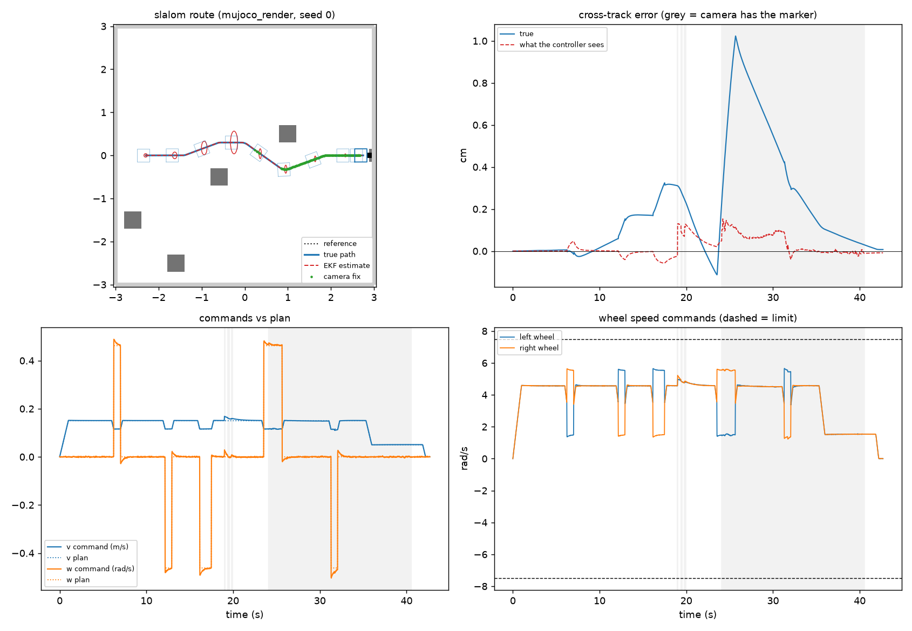
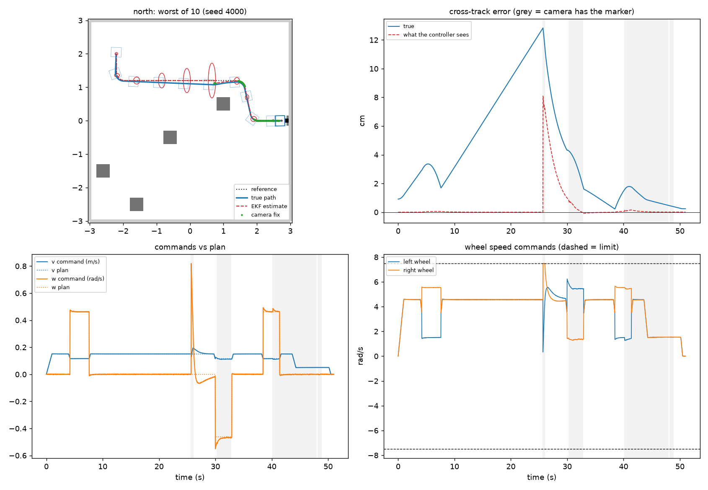
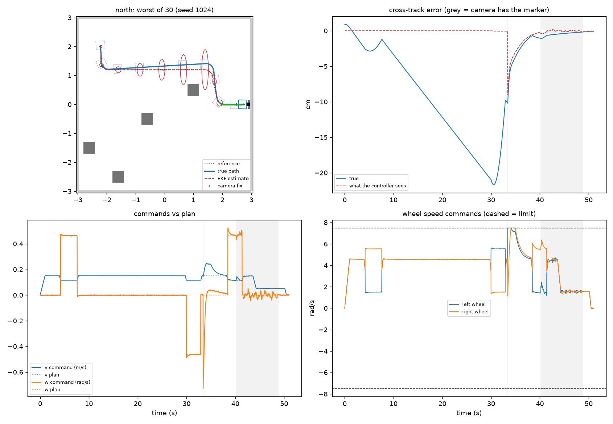
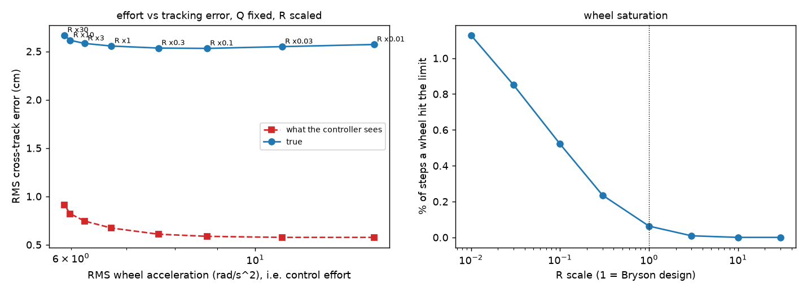
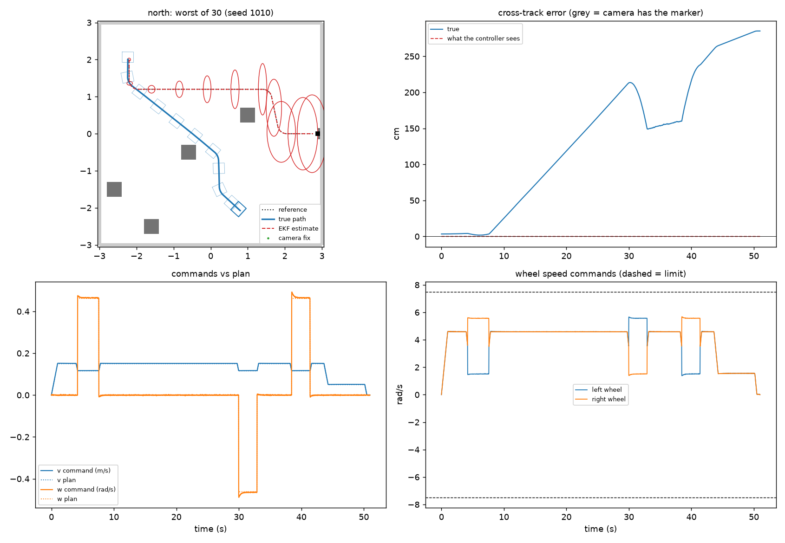

# Part D: Control (Andre)

An LQR trajectory tracker for the TurtleBot3 Waffle Pi. It drives a planned route around the
room's boxes and docks in front of the ArUco-marked station, in the group's MuJoCo scene. It only
ever uses the EKF estimate from `ekf.py` (Part C). The simulator's true pose is used to score
runs and nothing else, and section 2.9 shows how that's checked. In the integrated system
(`main.py`) the same tracker follows the legs from Part E's LiDAR planner (section 5).

| file in `part_d_control/` | what it is |
|---|---|
| `controller.py` | the controller: error model, LQR, gain schedule, reference trajectory, docking, wheel limits |
| `test_controller.py` | 19 checks: maths, logic, limits, the MuJoCo scene, and the ground-truth checks |
| `run_tracking.py` | closed-loop test bench in MuJoCo (or a fast stand-in): repeated trials, comparisons, plots |
| `results_part_d/` | everything `run_tracking.py` writes: plots, `.md` tables, `.csv` per trial |

**Run it** from the repository root, after installing `requirements.txt`:

```
python -m unittest part_d_control.test_controller -v                  the 19 checks
python -m part_d_control.controller                                   gains and stability, no simulator
python -m part_d_control.run_tracking --check-sim                     pre-flight: wheel slip and marker reading
python -m part_d_control.run_tracking                                 one run of each route, rendered camera, with plots
python -m part_d_control.run_tracking --viewer                        watch a run in the MuJoCo viewer
python -m part_d_control.run_tracking --leak-check                    ground truth never reaches the controller (section 2.9)
python -m part_d_control.run_tracking --camera synthetic --report     every batch result in section 2 (about 17 min)
python -m part_d_control.run_tracking --trials 10 --seed 4000         the rendered-camera trials in section 2.4 (about 65 min)
python -m part_d_control.run_tracking --plant kinematic --report      the kinematic stand-in's batches (section 2.1, about 3 min)
```

## 1. Design

Every 20 ms (the EKF's rate):

1. look up the planned pose and speeds at time t
2. tracking error e = planned pose − estimated pose, in the robot's frame: ahead e_x, left e_y, heading e_θ
3. **u = u_ref − K(v_ref, ω_ref) e**. The feedforward u_ref = (v_ref, ω_ref) does the planned motion; LQR feedback fixes the error
4. if a wheel would go past its limit, scale both wheels down by the same factor

### 1.1 Error model

Same model and sign convention as A4 in `model.py`, linearised about the moving reference and
discretised with Euler at dt = 0.02 s:

```
e[k+1] = A e[k] + B du[k]      A = [[ 1,      ω_r dt, 0      ],      B = [[-dt,  0 ],
                                    [-ω_r dt, 1,      v_r dt ],           [ 0,   0 ],
                                    [ 0,      0,      1      ]]           [ 0,  -dt]]
```

Assumptions: small errors, no wheel slip, reference speeds constant over one step. Exact ZOH
discretisation changes K by at most 0.6 % at this sample rate, so Euler is fine and matches the EKF.

### 1.2 Controllability, and why the robot docks while still moving

rank [B AB A²B] is 3 when v_ref > 0 and 2 when v_ref = 0: a stopped robot cannot correct a
sideways error (A5). Even when moving, the sideways direction gets weaker as the speed drops. So:

* gains are never designed for slower than **0.05 m/s**
* the robot comes into the dock on a **0.9 m straight along the marker's normal**, still moving
  (0.05 m/s for the last 0.30 m), so the sideways error is gone before it stops
* once the plan has ended, only e_x and e_θ are regulated (a 2-state LQR with the same weights).
  Feeding back e_y at a standstill would only turn the robot, not move it sideways.

### 1.3 Weights: Bryson's rule, 1 / (largest acceptable value)²

| | largest acceptable | why |
|---|---|---|
| e_x along the path | 0.10 m | running a little late is harmless |
| e_y across the path | 0.05 m | the routes leave about 0.25 m between the robot's side and the boxes, and docking needs it centred |
| e_θ heading | 10° | |
| dv extra speed | 0.10 m/s | cruise is 0.15 m/s, top speed 0.26 m/s |
| dω extra turn rate | 0.60 rad/s | at 0.15 m/s one wheel saturates past 0.76 rad/s |

On a straight at 0.15 m/s this gives **dv = 0.99 e_x, dω = 11.5 e_y + 3.8 e_θ**. Closed-loop time
constants: 1.0 s along the path, 0.30 s in heading, 1.9 s sideways (0.28 m of travel). In a
0.25 m-radius corner at 0.115 m/s the gain couples the axes (dv also reacts to e_y, dω to e_x)
and the slowest time constant is 1.2 s. Section 2.7 checks this choice against a sweep of R.

### 1.4 Gain schedule

A depends on v_ref and ω_ref, so K is re-solved (discrete Riccati, as in Week 6) for whatever
the plan is doing, and cached. Every (v_ref, ω_ref) the plan can ask for gives a stable loop
(unit-tested). A single gain designed for straight driving is also stable everywhere, but in the
routes' corners (0.25 m arcs at 0.115 m/s) its slowest time constant is 1.46 s instead of 1.19 s.

### 1.5 Reference trajectory

The planner's waypoints are joined by straight legs with 0.25 m arcs at the corners, so the
heading never jumps. The speed plan is:

* 0.15 m/s cruise and 0.15 m/s² acceleration, starting and ending at rest
* slower on arcs, so the plan uses at most 70 % of wheel speed and 30 % is left for feedback
* 0.05 m/s for the last 0.30 m into the dock

The feedforward turn rate is ω_ref = v_ref × curvature.

### 1.6 Docking

The dock pose has 5 cm between the robot's front and the marker face, centred, facing it.
Coming in along the marker's normal keeps the marker in the middle of the image, so the EKF gets
fixes all the way in and is most accurate exactly where it matters. The camera loses the full
marker about 7 cm before the end (too close), and the EKF coasts on odometry for that bit.

* **Docked** (what the controller decides from the estimate): |e_x| < 1 cm and |e_θ| < 2° for 0.5 s
* **Success** (how a run is scored, from the true pose): within 3 cm along, 2 cm sideways and 3°, with nothing hit

### 1.7 Wheel limits

When one wheel would pass 95 % of 7.88 rad/s, both wheels are scaled by the same factor. That
keeps v/ω, so the robot stays on the commanded curve and just slows down. Clipping one wheel
instead makes it turn less than asked.

### 1.8 Starting the wrong way round

If the robot starts more than 15° off the first leg's heading, it turns on the spot first
(heading is controllable at standstill), then starts the plan clock.

### 1.9 Why there's no integral action

The EKF is fed the encoders, i.e. the motion that actually happened, so a weak motor shows up
honestly in the estimate. Without integral action, a constant turn-rate disturbance d leaves a
steady sideways offset of d/k_y (k_y = 11.5 rad/s per m at cruise). If the left motor only gives
a fraction g of its command, keeping up with the plan at speed v takes d = v(1 − g)/(g L), so at
0.15 m/s the offset should be 5.0 mm for a 90 % motor and 11.3 mm for 80 %. In MuJoCo, on the
north route's 3.8 m straight, the controller held 5.0 mm and 11.2 mm
(`--camera synthetic --route north --wheel-gain 0.9 1`, then `0.8 1`). All 60 weak-motor trials
still docked inside tolerance (section 2.8). Integral action would remove those few mm, but it
adds a state that winds up during the EKF's big corrections (section 2.5), so I left it out.

## 2. Results

### 2.1 Set-up

* **Simulator:** the group's MuJoCo scene (`sceneforturtle.xml`) and Waffle Pi model, with one
  correction to how the robot touches the floor, applied when the model loads (section 3.1).
  The xml files aren't changed.
* **Pipeline:** MuJoCo's wheel angles, rounded to encoder ticks (4096 per turn, ±1 tick noise)
  → odometry → `ekf.predict` at 50 Hz. Marker range and bearing → `ekf.update` at 10 Hz whenever
  the marker is in view. `ekf.py` is used unchanged, with Part C's design Q and R as in the
  pipeline.
* **Camera, two versions.** *Rendered:* MuJoCo draws the robot's camera image, OpenCV finds the
  ArUco marker, `solvePnP` says where it is, and that becomes range and bearing. That's the real
  sensing path, but software rendering takes about 2 minutes a run on our test machine. Before trusting it I put the
  robot at 8 known spots (`--check-sim`). It saw the marker at the 7 where it should, with range
  within about 1 % and bearing within 0.1°. *Fake* (`--camera synthetic`): when the marker
  would be in view, it reports the true range and bearing plus Gaussian noise, σ = 2 mm + 1 % of
  the range and 0.5° of bearing. I set that before Part B measured the camera, and it's larger
  than what Part B found (at most 7 mm of spread up to 2 m, and hundredths of a degree;
  `PART_B_SENSING.md`, B7), so the fake camera is the pessimistic one. It's about 60 times faster, so the batch
  results use it, and section 2.4 checks it against the rendered camera.
* **Routes:** three test routes from different corners (slalom, north, south), each ending in the
  docking leg. They stand in for the planner's waypoints and keep at least 0.40 m between their
  centre line and every box (unit-tested).
* **Start:** the robot is put down with 2 cm / 1.5° (1σ) of error. The EKF only knows where it
  was meant to be put down.
* **Stand-in:** I tuned on a kinematic stand-in (unicycle plus the xml's wheel servo) before
  MuJoCo was set up. Its 90-trial numbers agree with MuJoCo's to within half a millimetre on
  every distance mean (`summary_kinematic_x30.md` against `summary_mujoco_synthetic_x30.md`), so
  the tuning carried over unchanged.

### 2.2 Nominal run, rendered camera



With no placement error, so the EKF's starting guess is exactly right: RMS cross-track of
0.52 cm on average (0.65 cm on the worst route), and docked within 0.03 cm sideways, 0.25° and
0.25 cm along on all three routes.

### 2.3 90 random trials (MuJoCo, fake camera)

**Docked within tolerance 90/90, no collisions.**

| | mean | sd | worst run |
|---|---|---|---|
| RMS cross-track, true (cm) | 3.66 | 1.97 | 9.60 |
| peak cross-track, true (cm) | 8.06 | 4.46 | 21.67 |
| RMS cross-track the controller sees (cm) | 0.92 | 0.61 | 2.65 |
| EKF position error, RMS (cm) | 4.14 | 1.90 | 10.51 |
| dock error along (cm) | 0.06 | 0.07 | 0.25 |
| dock error sideways (cm) | 0.01 | 0.15 | 0.40 |
| dock heading error (°) | −0.07 | 0.64 | 1.56 |
| RMS feedback turn rate (rad/s) | 0.035 | 0.020 | 0.085 |
| steps with a wheel at its limit (%) | 0.47 | 0.78 | 3.42 |
| time to dock (s) | 46.1 | 3.6 | 51.0 |

### 2.4 Rendered camera against the fake one

The same 30 trials (10 per route, same random starts) through the real camera path, compared
run for run with the fake camera:

| | rendered camera | fake camera |
|---|---|---|
| docked within tolerance | 30/30 | 30/30 |
| RMS cross-track, true (cm) | 2.53 ± 1.25 | 3.08 ± 1.48 |
| EKF position error, RMS (cm) | 2.93 ± 1.23 | 3.48 ± 1.44 |
| RMS cross-track the controller sees (cm) | 0.59 ± 0.39 | 0.68 ± 0.43 |
| dock error sideways (cm) | 0.04 ± 0.11 | 0.08 ± 0.13 |
| dock error along (cm) | 0.25 ± 0.00 | 0.09 ± 0.08 |
| dock heading error (°) | −0.25 ± 0.45 | −0.24 ± 0.57 |
| camera fixes per run | 145 | 128 |

The rendered camera does a little better, not worse: lower true error in 25 of the 30 pairs,
0.56 cm lower on average. The real detector finds the marker in about 18 more frames per run
than the fake camera's rules allow, sometimes from further away and at steeper angles, so the
EKF gets corrected sooner. Its one quirk is the small steady range error from section 2.1, which
makes the robot stop 2.5 mm short of the dock every time, well inside the 3 cm tolerance. The
EKF's gate threw out 2 of its 4365 readings. So the fake camera is a fair, slightly pessimistic
stand-in, and the batch numbers in this section are, if anything, conservative.



In the worst rendered trial the robot drifts 12.8 cm on odometry alone. The camera picks up the
marker at about 26 s, the controller pulls the robot back within a few seconds, and it docks
normally.

### 2.5 Where the error comes from

The controller holds its estimate on the plan to 0.9 cm RMS. The true error is four times
bigger, and almost all of that is estimation error (EKF position error 4.1 cm RMS). With the
16 cm marker and `sensing.py`'s 30 px rule, the camera only sees the dock from about 2.2 m or
closer. So the first 3–4 m of every route is odometry alone, and a 1.5° start heading error has
become about 10 cm sideways by then. When the marker comes into view the estimate jumps (up to
about 17 cm) and the controller pulls the robot back within 3–5 s, briefly at the wheel limit.
Docking is accurate because the whole final 0.9 m has camera fixes.



In the worst trial above the robot is 22 cm off the path while the controller sees almost
nothing wrong. The first camera fix at t ≈ 33 s shows the error, and the robot is back on the
path and docks normally.

### 2.6 Design comparison (10 trials per route, same seeds for every variant)

| variant | docked ok | RMS e_y true (cm) | max e_y true (cm) | RMS e_y seen (cm) | max e_y seen (cm) | RMS feedback ω (rad/s) | wheel limit (% of steps) |
|---|---|---|---|---|---|---|---|
| **final: scheduled LQR + feedforward** | 30/30 | 2.92 | 18.42 | 0.77 | 14.23 | 0.031 | 0.3 |
| one fixed gain (straight line, 0.15 m/s) | 30/30 | 2.93 | 18.42 | 0.78 | 14.24 | 0.037 | 0.3 |
| no turn-rate feedforward | 30/30 | 3.02 | 18.78 | 1.09 | 13.99 | 0.085 | 0.4 |

* **Feedforward matters most.** Without it the feedback has to find the turn rate from the
  error, so the error it sees is 40 % bigger and the feedback effort 2.7 times higher.
* **Scheduling** saves about 16 % of the feedback effort. Tracking is nearly the same because
  the corners are short. I kept it because it costs nothing at run time and helps more in
  tighter turns.
* The worst "seen" error (about 14 cm) is the same for all three. It's the EKF's first
  correction, not something the controller did.

### 2.7 Effort against tracking error (Q fixed, R scaled)



| R scale | 0.01 | 0.1 | **1 (final)** | 10 | 30 |
|---|---|---|---|---|---|
| RMS e_y true (cm) | 2.57 | 2.53 | 2.56 | 2.62 | 2.67 |
| RMS e_y seen (cm) | 0.58 | 0.59 | 0.67 | 0.82 | 0.91 |
| RMS wheel acceleration (rad/s²) | 13.9 | 8.7 | 6.7 | 6.0 | 5.9 |
| steps with a wheel at its limit (%) | 1.13 | 0.52 | 0.06 | 0 | 0 |

Making the controller 100 times more aggressive than the Bryson design doesn't reduce the true
error at all (2.56 to 2.57 cm). It doubles the wheel acceleration and hits the wheel limit 18
times as often. Across a 3000-fold range of R the true error only moves between 2.53 and
2.67 cm, because it's capped by the estimate, not the gains. Bryson's design sits at the knee:
about the most aggressive setting that barely touches the wheel limit (0.06 % of steps).
**What limits the gains:** the wheel speed limit, and the EKF's corrections, which a high-gain
controller turns straight into wheel jerks.

### 2.8 Weak motor (10 trials per route each, same seeds in every row)

| left motor | docked ok | dock sideways (cm) | dock along (cm) | RMS feedback ω (rad/s) |
|---|---|---|---|---|
| 100 % | 30/30 | 0.08 ± 0.13 | 0.09 ± 0.08 | 0.025 |
| 90 % | 30/30 | −0.20 ± 0.14 | 0.23 ± 0.08 | 0.061 |
| 80 % | 30/30 | −0.54 ± 0.15 | 0.42 ± 0.07 | 0.123 |

The feedback has to supply the turn rate the weak motor loses (about 0.06 rad/s at cruise speed
for a 10 % loss), so its RMS goes up with the mismatch. The docking offset grows as d/k_y predicts and
stays far inside the 2 cm tolerance.

### 2.9 Ground truth never reaches the controller

The brief says the controller must use the estimated state, never ground truth. Here is every
place the true pose is read, and how I checked that none of it gets to the controller.

**Where the true pose is read.** All in `run_tracking.py`. `controller.py` and `ekf.py` never
touch the simulator.

| where | what for | reaches the controller? |
|---|---|---|
| `truth()`, once per step in `run()` | the referee: logged for scoring, and ends the run if the real robot touches a box | no |
| `truth()` in `--check-sim` | the pre-flight check, before any run | no |
| `_pose()` inside the fake camera | to work out what a camera would see from there, the way MuJoCo's renderer does for the rendered camera | only as a camera reading, like any sensor |

**What the control path gets:** encoder ticks and the camera's range and bearing. The EKF turns
those into x̂, and `LQRTracker.step` takes only x̂ and the time.

**Things that look like ground truth but aren't:**

* *Where it starts.* The EKF starts at the planned start pose with 2 cm / 1.5° of uncertainty.
  In the random trials the robot is really put down that far off, and the EKF isn't told. (In
  the nominal runs the placement is exact, which is why they look so good. The random trials are
  the honest numbers.)
* *Where the marker is.* The dock's position is a fixed map value, read once from the scene file.
  The EKF in Part C is built around a known landmark. On the real robot we'd measure it once.
* *Where the boxes are.* Only the referee and the route-clearance test use them. The test routes
  are hand-written stand-ins for the LiDAR planner, and the controller never sees the boxes.

**Checks:**

1. **Leak check** (`--leak-check`, also a unit test). Run the same trial twice, the second time
   with the simulator's `truth()` swapped for one that only returns NaN. Every wheel command
   comes out bit-for-bit the same. In MuJoCo with the rendered camera, where nothing in the loop
   needs the pose at all so I blank the simulator's own `_pose()` too: 2135, 2550 and 2227
   steps on the three routes, all identical. The core test repeats it with the fake camera in MuJoCo.
2. **The slipping robot shows it from the other side** (section 3.1). With the robot exactly as
   the xml says, the controller kept its estimate on the plan (1.3 cm RMS on average) while the
   real robot ended up as far as 3.2 m from the dock, and in 84 of 90 runs it stopped and called
   itself docked. A controller that could see the true pose would have steered back.

The rest of the repo is fine too: `simulation_turtlebot.py` prints the true pose for checking
only, `sensing.py`'s calibration moves the robot to set spots to take photos, and `ekf.py`'s
`nees()` takes the true pose only to score the filter.

## 3. Problems found and fixed

### 3.1 The Waffle Pi slips in MuJoCo as the xml stands

`--check-sim --as-is` (the robot exactly as the xml says): driving straight, the wheels say
0.522 m but the robot only moves 0.442 m (15 % short). Spinning on the spot, the wheels say 116°
and it turns 81° (30 % less). Two causes, both in the ROBOTIS model the group's xml comes from:

* the chassis collision shape (the convex hull of the base mesh) reaches 0.1 mm below the wheel
  bottoms, so it rests on the floor and drags with friction 1
* the ball casters are meant to be frictionless (`condim="1"`), but MuJoCo uses the larger
  friction and condim of the two touching geoms, so the floor's friction wins

Left like that, only **1 of 90** trials docked and 6 hit a box. The robot turns about 30 % less
than its encoders say, so the EKF's heading goes wrong at every corner and the robot leaves the
route. On the slalom and north routes it never saw the marker at all (60 of the 90 runs). On
the south route it did, but still ended a median 14 cm from the dock.



In the worst one above, the robot under-turns at the first corner and heads off diagonally. It
never sees the marker, so nothing corrects the estimate, and it ends up 2.85 m from the dock
while the controller sees no error at all.

The fix (`fix_floor_contacts()` in `part_e_integration/sim.py`) gives the casters contact
priority, so their own frictionless contact is used, and lifts the chassis collision shape
2.1 mm so it clears the floor by 2 mm. Only the wheels and casters touch the floor, which is how
the real robot works. Slip drops under 1 % (0.525 m against 0.522 m, 117.2° against 116.7°), and
a unit test keeps it there.

**Shared by every part.** `sim.load()` applies the fix whenever the scene is loaded, so the
integrated pipeline, Part A's model check and this test bench all drive the same robot. Part A's
`validatemodel.py` shows the same thing from the model side: with the fix the unicycle model
matches MuJoCo to within 1 cm and 1°; without it the error reaches 38 cm and 106°. The xml
files are left as ROBOTIS ships them, so the slip can still be reproduced (`--as-is`). Making the
fix permanent in `turtlebot3_waffle_pi.xml` takes two edits (then `fix_floor_contacts` does
nothing):

* add `priority="1"` to the two caster `<geom type="sphere" ...>` lines
* change the chassis collision geom `<geom pos="-0.064 0 0.01" mesh="waffle_pi_base" class="collision"/>`
  to `pos="-0.064 0 0.0122"`

### 3.2 The first slalom route clipped a box

On the stand-in, the first slalom route clipped box1 in 2 of 10 trials. Both happened before any
camera fix (the dock was out of range). Those trials had a 2.8–3.4° start heading error, so the
robot was 15 cm off the path while the controller saw under 1 mm of error, and the route passed
box1 with only 0.28 m of centre-line clearance. Fix: a 0.40 m clearance rule for routes, now
unit-tested. **For whoever plans the route:** keep 0.40 m from obstacles until the marker is in
view.

### 3.3 The speed plan went over its own wheel budget

By 2–4 % where a straight meets an arc. A unit test caught it. Fixed by giving the points at
each join the arc's speed limit.

### 3.4 Camera reading

`solvePnP` with `SOLVEPNP_IPPE_SQUARE` sometimes returned NaN while reporting success, and
without subpixel corner refinement the range read about 2 % long at 1 m. Fixed with a NaN check
plus fallback solver, and `CORNER_REFINE_SUBPIX`. In the rendered MuJoCo scene the reading is
then within about 1 % in range and 0.1° in bearing (section 2.1). Part B's `sensing.py` now
refines its corners the same way and checks for NaN poses, so the test bench and the pipeline
read the marker alike (`PART_B_SENSING.md`, "Problems found and fixed").

## 4. Limits

* The batch results use the fake camera. The rendered-camera trials in section 2.4 are the check
  that it's a fair stand-in. The fake camera also ignores boxes blocking the view, but none of
  the 11469 camera fixes in the 90 trials of section 2.3 would have been blocked (`blocked_fixes`
  in `trials_mujoco_synthetic_x30.csv`, a line-of-sight check against every box).
* The floor-contact fix (section 3.1) makes the simulated robot roll the way its encoders say,
  as a TurtleBot does on a hard floor. Real slip (carpet, a wet floor, hard braking) isn't
  modelled, and nothing in the controller detects it.
* The controller is linear and assumes small errors. Big EKF jumps are handled by the
  curvature-preserving wheel scaling, but nothing re-plans the path after a jump.
* The plan is timed. If the robot is held up, it falls behind and then hurries to catch up. A
  re-plan, or letting the reference wait for the robot, would fix that.
* There's no obstacle avoidance in the controller; it trusts the route.

## 5. How the integrated pipeline uses it

The test bench above drives hand-written routes. In the integrated system (`main.py`), Part E's
LiDAR planner (`part_e_integration/navigation.py`) chooses the waypoints and the same tracker
follows them:

```python
from part_d_control import controller
# one straight leg to the next waypoint the A* planner chose
tracker = controller.LQRTracker(controller.Reference([x_hat[:2], waypoint], final_straight=0.0))
# at the pre-dock point: the 0.9 m straight approach into the dock
tracker = controller.LQRTracker(controller.Reference([pre_dock, dock]))
# every 20 ms, after the EKF update:
v, w = tracker.step(x_hat, t)
w_left, w_right, _ = controller.wheel_speeds(v, w)
```

* The planner re-plans and starts a new leg when a LiDAR scan blocks the current one, so the
  plan is followed one leg at a time and the robot stops briefly between legs. The test bench's
  routes are joined by arcs instead, so its results here describe the controller on smooth
  routes; Part E reports the integrated system's results.
* The controller uses Part A's `linear_error_model()` and `body_to_wheels()` (it kept its own
  copies until Part A was finished; the unit tests checked they agreed).
* The tracker reports `timeout` if settling at the dock takes longer than 5 s, and only
  sustained in-tolerance settling reports `docked`.
* On the real robot only the wheel command changes: the TurtleBot's firmware does the wheel
  mapping, so the scaled (v, w) would be sent as a velocity command.
* The floor-contact correction (section 3.1) is applied when the scene loads (`sim.load()`), so
  every part drives the same, non-slipping robot.

## Generative AI

Claude (Anthropic) was used to help design, code and test the controller and the test bench,
and to write this report. The final re-run of every result in section 2 was also done with
Claude's help. The team's full declaration is in the repository README.
