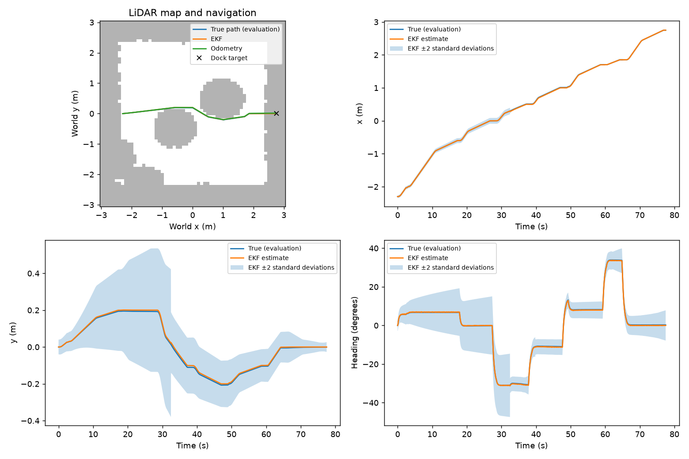
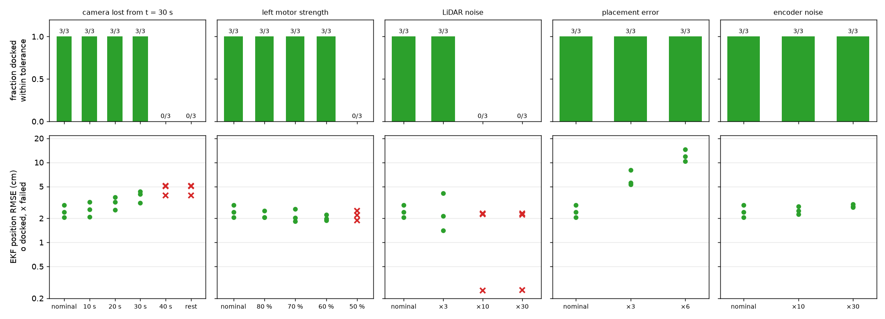

# Part E: Integration and robustness (Abdul, then Andre)

Part E joins the other four parts into one closed loop in MuJoCo: the rendered camera and LiDAR, Part B's sensing functions, Part A's model, Part C's EKF and Part D's LQR. The robot maps obstacles with its LiDAR, plans a path with A* to a point in front of the dock, follows it one straight leg at a time, then makes a straight visual approach and docks. The simulator's true pose is read only after each step's commands are computed, to score the run.

Abdul wrote the first version (simulator interface, sensor adapter, LiDAR planner and pipeline). Andre finished the integration and added the robustness study.

| file in `part_e_integration/` | what it is |
|---|---|
| `pipeline.py` | the closed loop (`Pipeline.step`), trial set-up, logging, scoring and plots; `main.py` runs it |
| `navigation.py` | LiDAR obstacle map, A* planner and leg-by-leg navigation to the dock |
| `sensor_adapter.py` | connects Part B's functions to the scene, and scales sensor noise for robustness tests |
| `sim.py` | loads the scene with the floor-contact correction; camera, LiDAR, encoders; `truth()` for scoring only |
| `robustness.py` | the robustness study in section "Robustness study" |
| `test_pipeline.py` | checks that the loop never sees the true pose |
| `results_pipeline/` | the default run of `main.py`: log, summary and plot |
| `results_robustness/` | the robustness study: one CSV per condition, `summary.md`, `robustness.png`, a plot of every failed trial (each trial's sensor log goes to `logs/`, which Git ignores) |
| `results_robustness_measured_R/` | the same study with Part B's measured R in the EKF, for comparison |

## Run and reproduce

From the repository root, after installing `requirements.txt`:

```
python main.py                                   one docking run from the west start (about 3 minutes)
python main.py --viewer                          the same run in the MuJoCo viewer
python main.py --start south --placement-noise --trials 3 --seed 20 --wheel-gain 0.9 1 --camera-dropout 25 30
python -m unittest part_e_integration.test_pipeline -v
python -m part_e_integration.robustness --all    the whole robustness study (about 3.5 hours)
python -m part_e_integration.robustness --report tables and plot from the saved results
python -m part_e_integration.robustness --all --measurement-noise part_b_sensing/results_part_b/camera_R_calibrated.npz --output part_e_integration/results_robustness_measured_R
```

`python main.py --help` lists every option. By default the camera uses Part B's calibrated intrinsics (`--nominal-camera` for the ideal K) and the EKF uses Part C's design noise, the setting Part C's study chose (`--measurement-noise` loads Part B's measured R). The robustness options scale one thing at a time: `--placement-scale`, `--lidar-noise-scale`, `--encoder-noise-scale`, plus `--wheel-gain` and `--camera-dropout`. Use a different `--output` for each set of conditions; a plain `python main.py` replaces the committed run in `results_pipeline/`.

A trial ends when the robot docks, the tracker times out, or 150 s pass. **Success** means docked with the true final pose within 3 cm along the dock axis, 2 cm sideways and 3°, and no contact with a box.

## Follow one control step

```text
Wheel angles -> Part B noisy_encoders + odometry -> Part C EKF predict
Camera image -> Part B detect_marker + frame conversion -> EKF update
LiDAR ranges -> Part B noisy_lidar -> obstacle map -> A* waypoints
Estimated pose + next waypoint -> Part D LQR -> Part A wheel conversion -> MuJoCo

True pose -> evaluation, logs and plots only
```

The loop runs every 0.02 s. Encoders, prediction and control run at 50 Hz; camera and LiDAR at 10 Hz. During camera loss the EKF keeps predicting from the encoders and carries its uncertainty forward.

The state is `[world x, world y, heading]`, in metres and radians. Odometry gives `[forward speed, yaw rate]` in m/s and rad/s. The camera supplies planar range in metres and bearing in radians, relative to the robot base. Wheel commands are left/right angular velocities in rad/s. The LQR receives the EKF estimate.

## How the parts are joined

### `pipeline.py`: one loop and its evaluation

`Pipeline.step()` takes wheel angles, the time, a LiDAR scan and an image. It has no simulator argument, so it cannot read the true pose. `run_trial()` sets up a trial, calls the step, and then, separately, logs the true pose and contacts for scoring. Part B's noise uses NumPy's global random generator, so each trial seeds it, and the same seed repeats a run exactly.

Every trial writes:

* `<start>_seed<N>.npz`: timestamps, true, estimated and odometry poses, the **full 3 × 3 covariance**, wheel commands, camera update flags, control references, navigation modes, the obstacle map and NEES. Part C's replay inputs (odometry, camera measurements, pre-gate NIS, initial conditions, Q and R) are included.
* `<start>_seed<N>.json`: the trial's settings, success, collision flag, docking errors, estimator and cross-track RMSE, wheel-command RMS, camera acceptance and rejection counts, and mean NEES.
* `<start>_seed<N>.png`: the path on the LiDAR map, and all three estimated states with ±2σ next to the truth.
* `summary.csv`: one row per trial in that run.

### `sim.py`: simulator access

It loads the scene, reads sensors by name, renders the `rgb` camera and advances the physics ten 2 ms steps per control step. `load()` applies Part D's floor-contact correction (casters get contact priority, the chassis collision mesh is lifted clear of the floor), so every part drives the same robot that rolls the way its encoders say; the xml files are unchanged. `truth()` and `collided()` are for scoring only. The camera mount, LiDAR mount and marker position are read from the model: fixed dimensions and a known landmark, not the robot's live pose.

### `sensor_adapter.py`: Part B connection

The adapter calls Part B's encoder, odometry, LiDAR, marker detection and frame conversion functions, with the camera intrinsics from Part B's calibration. When the pipeline starts it checks that Part B's marker size (0.16 m) and camera mount (`[0.07, 0, 0.15]` m) match the scene, so a change to either can't silently scale every range. Non-finite camera outputs are discarded before the EKF. For the robustness study it can multiply Part B's LiDAR and encoder noise.

### `navigation.py`: LiDAR navigation

The map is a 0.10 m grid over the known 6 × 6 m room. Internal obstacles come from LiDAR endpoints, placed using the estimated pose and the LiDAR mounting offset; obstacle locations are never read from the simulator. Beams with no return are left out using the sensor's own no-return mask.

Each observed endpoint blocks cells within 0.40 m (robot half-width plus margin). A* finds a path to the pre-dock point, 0.9 m before the docking pose on the marker's normal, and line-of-sight simplification reduces the grid path to a few waypoints. The LQR tracks one straight leg at a time, stopping and aligning between legs. If a new scan blocks the rest of a leg, the robot re-plans from its estimate.

A 0.15 m start allowance lets the robot leave the inflated margin around its own position. Without it, noise or placement error can trap a safe robot inside its own clearance margin. It only relaxes the start of a leg; it does not erase mapped obstacles or relax the destination.

At the pre-dock point the controller follows Part D's 0.90 m final straight into the dock. This leg-by-leg method is simple and easy to check, but slower than Part D's smooth routes.

### Changes to Part D's code for integration

`controller.py` calls Part A's `linear_error_model()` and `body_to_wheels()` instead of keeping its own copies; gains and weights are unchanged. The tracker reports `timeout` when settling at the dock takes too long, and only sustained in-tolerance settling reports `docked`. Part D's test bench (`run_tracking.py`) shares the contact correction from `sim.py`. Its results are for Part D's own routes and are reported in `PART_D_CONTROL.md`, not here.

## Results

### Nominal trials

Nine trials, three from each start, each with a random 2 cm / 1.5° placement error the EKF isn't told about (seeds 500–502 from the west, 510–512 from the north, 520–522 from the south). They are the nominal rows of the robustness study below.

| Start | Docked within tolerance | EKF position RMSE (cm) | Odometry RMSE (cm) | Mean NEES | Worst final error: along / sideways / heading | Time to dock (s) | Camera fixes per run |
|---|---|---|---|---|---|---|---|
| West | 3/3 | 2.46 | 4.63 | 0.55 | 0.24 cm / 0.11 cm / 0.55° | 74 | 333 |
| North | 3/3 | 2.81 | 7.16 | 0.56 | 0.24 cm / 0.08 cm / 0.43° | 67 | 320 |
| South | 3/3 | 4.69 | 15.06 | 0.83 | 0.24 cm / 0.28 cm / 1.22° | 44 | 175 |

All nine docked with no collisions, every final error well inside the tolerance. Across them the EKF's position error is 63 % smaller than odometry alone (3.32 cm against 8.95 cm RMS), and its NEES of about 0.6 is on the conservative side, as Part C chose. Most of the EKF's error comes before the first camera fix, 17–37 s into a run, when the unknown placement error has had time to drift: in two south runs the estimate was 17–18 cm out just before the fix, and after it the error stays under 2.5 cm RMS in every run.

`python main.py` runs the west start with an exact placement. It docks at 77.5 s, 0.24 cm short along the dock axis, 0.03 cm sideways and 0.27° off, with an EKF error of 0.9 cm RMS:



Counting Part C's 27 closed-loop runs from the same three starts, every nominal run of the full pipeline docked within tolerance.

### Robustness study

Each condition changes one thing from the nominal west trial and runs the same three seeds (500–502), each with the usual random placement error, so every level faces the same starts. Each disturbance is pushed until docking fails. The noise levels multiply Part B's models: LiDAR σ = 7.5 mm + 2.5 % of the range, encoder σ = one tick, placement 2 cm and 1.5° (one standard deviation). The camera is cut from t = 30 s because from the west start it first sees the marker 33–37 s in. [`results_robustness/summary.md`](results_robustness/summary.md) has the full table, and every failed run has its own plot in that folder.

| Disturbance | Still docks at | Fails at | How it fails | Where the cause is |
|---|---|---|---|---|
| Camera lost from t = 30 s | 30 s of loss (3/3 at 10, 20 and 30 s) | 40 s of loss or for good (0/3 each) | docks on odometry alone, 5.4–8.0 cm sideways | estimation: no absolute fix, and docking ignores the covariance |
| Left motor weak | 60 % (3/3 at 80, 70 and 60 %) | 50 % (0/3) | docks 2.3–2.4 cm sideways | control: steady offset without integral action |
| LiDAR noise | ×3 (3/3) | ×10 and ×30 (0/3 each) | never leaves the start | mapping: noise becomes obstacles that block every path |
| Placement error | ×6, i.e. 12 cm and 9° (3/3) | not reached | – | – |
| Encoder noise | ×30 (3/3) | not reached | – | – |

Every run, condition by condition (failed levels in bold):

| Condition | Level | Docked | EKF position RMSE (cm) | Odometry RMSE (cm) | Mean NEES | Sideways at the dock (cm) | Camera readings rejected per run |
|---|---|---|---|---|---|---|---|
| nominal | west | 3/3 | 2.46 | 4.63 | 0.55 | 0.09 | 1 |
| nominal | north | 3/3 | 2.81 | 7.16 | 0.56 | 0.04 | 2 |
| nominal | south | 3/3 | 4.69 | 15.06 | 0.83 | 0.19 | 0 |
| camera lost from t = 30 s | 10 s | 3/3 | 2.62 | 4.16 | 0.47 | 0.08 | 1 |
| camera lost from t = 30 s | 20 s | 3/3 | 3.13 | 4.68 | 0.20 | 0.06 | 0 |
| camera lost from t = 30 s | 30 s | 3/3 | 3.81 | 4.68 | 0.21 | 0.27 | 0 |
| camera lost from t = 30 s | 40 s | **0/3** | 4.66 | 4.66 | 0.22 | 6.87 | 0 |
| camera lost from t = 30 s | rest of run | **0/3** | 4.66 | 4.66 | 0.22 | 6.87 | 0 |
| left motor strength | 80 % | 3/3 | 2.20 | 4.30 | 0.69 | 0.48 | 3 |
| left motor strength | 70 % | 3/3 | 2.16 | 3.98 | 0.73 | 0.90 | 1 |
| left motor strength | 60 % | 3/3 | 2.02 | 3.65 | 0.66 | 1.40 | 2 |
| left motor strength | 50 % | **0/3** | 2.18 | 3.66 | 0.66 | 2.34 | 3 |
| LiDAR noise | ×3 | 3/3 | 2.56 | 4.98 | 0.35 | 0.03 | 1 |
| LiDAR noise | ×10 | **0/3** | 1.60 | 1.60 | 0.15 | – | 0 |
| LiDAR noise | ×30 | **0/3** | 1.59 | 1.59 | 0.14 | – | 0 |
| placement error | ×3 | 3/3 | 6.30 | 12.91 | 1.77 | 0.21 | 0 |
| placement error | ×6 | 3/3 | 12.28 | 23.66 | 6.25 | 0.35 | 0 |
| encoder noise | ×10 | 3/3 | 2.52 | 4.87 | 0.63 | 0.08 | 2 |
| encoder noise | ×30 | 3/3 | 2.86 | 5.55 | 0.90 | 0.11 | 2 |

33 of the 48 disturbed runs docked within tolerance, and all 9 nominal ones.



#### Where it breaks, and why

**Camera loss.** From the west start the marker is in view from 33–37 s until about 2 s before the robot stops. With 30 s of loss the camera comes back at 60 s, about 11 s before the robot stops; that gives about 90 fixes, and the robot docks within 0.4 cm sideways. With 40 s of loss it gets no fix at all, so the 40 s and rest-of-run rows are the same runs. The robot docks on odometry alone, its EKF error equals the odometry error (4.7 cm RMS), and it stops 5.4–8.0 cm to the side of the dock. The EKF knew it was lost: by the end its sideways ±2σ band was ±1.2 m wide ([`failed_camera_loss_rest_seed502.png`](results_robustness/failed_camera_loss_rest_seed502.png)). The fault is in what the system does with that: the docking rule trusts the estimate however large its covariance. Refusing to dock, or turning to look for the marker, when the covariance is that large would turn a silent miss into a detected one.

**Weak motor.** The EKF sees a weak motor through the encoders, and the robot still docks with the left motor at 60 %. The sideways offset at the dock grows with the imbalance: 0.5 cm at 80 %, 0.9 cm at 70 %, 1.4 cm at 60 %, and 2.3–2.4 cm at 50 %, past the 2 cm tolerance. That is the steady offset a controller without integral action leaves (Part D, section 1.9), and it grows roughly as (1 − g)/g for a motor at fraction g. The EKF's final estimate agreed with the true offset to within 0.15 cm, so the estimator was not the problem; integral action on the sideways error during the final approach would remove it.

**LiDAR noise.** At three times Part B's noise the planner still finds its way. At ten times, the noise is a quarter of each range, so beam endpoints land far from any surface. Each one is inflated by 0.40 m and the map never clears a cell, so within a few scans phantom obstacles close every path ([`failed_lidar_noise_x10_seed500.png`](results_robustness/failed_lidar_noise_x10_seed500.png)). The robot turns towards its first leg, then waits out the 150 s limit 5 m from the dock; at thirty times it never moves. The estimator and controller are fine, since the EKF holds 1.6 cm RMS while it stands still; the cause is the mapping. Marking a cell only after repeated hits, and clearing cells that later beams pass through, would let it tolerate far more noise.

**Placement error and encoder noise** didn't stop it at the levels tested. With six times the placement error (12 cm and 9°, one standard deviation) the first camera fix pulls the estimate in and the robot docks within 0.4 cm sideways. Before that fix the EKF is overconfident (mean NEES 6.3), because it still starts with 2 cm and 1.5° of uncertainty. At thirty times the encoder noise the odometry-only error rises from 4.6 to 5.6 cm RMS, but the camera keeps correcting the estimate: the EKF error goes from 2.5 to 2.9 cm, and its NEES stays below 1.

#### The same study with Part B's measured R

The whole study was also run with Part B's measured R in the EKF ([`results_robustness_measured_R/`](results_robustness_measured_R/summary.md)). It docked in 42 of 57 runs, the same as here, failing in the same conditions for the same reasons. The difference is in the weak-motor runs: in one 80 % run and one 70 % run, a bad first camera reading got through the gate and shut the camera out for 29 s and 8 s (Part C explains how). At 80 % those runs rejected 99 camera readings each on average, against 3 here, and the EKF error was 3.6 cm against 2.2 cm. This is why the pipeline keeps Part C's design R.

## Ground truth is only used for evaluation

`Pipeline.step()` has no access to the simulator. `test_pipeline.py` checks three things: the step's inputs are only sensor readings and time; the code that runs inside the loop (the `Pipeline` class, the planner, the adapter, the EKF's predict and update, and Part B's in-loop functions) never names the simulator, `truth`, `qpos` or `sensordata`; and running the same trial with `truth()` returning NaN gives identical wheel commands and estimates. The EKF starts from the intended placement, not the true one, and in the trials with placement noise the robot is really put down off that pose without the EKF being told.

## Limits

* Unknown space is treated as free. The map accumulates obstacle hits and never clears them, so large pose drift or moving obstacles make it conservative. If no path exists, the robot holds still until the time limit. This is not a general SLAM system.
* LiDAR re-planning only applies up to the pre-dock point. The final straight assumes the docking corridor is clear.
* Q and R are design values, tuned and checked in simulation (Part C, with Part B's measured R as the comparison); neither has been checked on the real robot.
* The docking rule trusts the estimate whatever its covariance. With the camera gone for the last 40 s, the robot docks on odometry alone, 5–8 cm to the side, even though its own sideways uncertainty is over a metre.
* There is no integral action, so a motor that keeps less than about half its strength leaves the robot more than 2 cm to the side of the dock.
* A LiDAR ten times noisier than Part B's model fills the map with phantom obstacles, and the planner gives up.
* Three seeds per level show where each failure starts, not how often it happens near that level.

## Generative AI

The first version of this integration was written with OpenAI Codex for code, tests and documentation. The final integration, the robustness study and this report were done with Claude (Anthropic). The team's full declaration is in the repository README.
