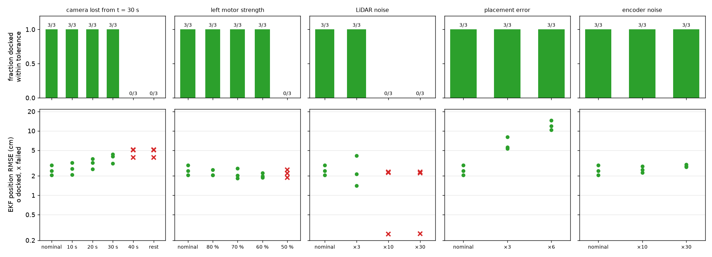

# Part E robustness study

Made by `python -m part_e_integration.robustness`, with Part C's design Q and R in the EKF. Full pipeline with the rendered camera; seeds 500, 501, 502 (north +10, south +20) in every row, each with a random 2 cm / 1.5° placement error the EKF is not told about. Success = docked within 3 cm along, 2 cm sideways and 3° (true pose), with no collision.

| Condition | Level | Docked OK | EKF position RMSE (cm) | Odometry RMSE (cm) | Mean NEES | Sideways at the dock (cm) | Camera fixes | Camera readings rejected | Time (s) | Failures |
|---|---|---|---|---|---|---|---|---|---|---|
| nominal | west | 3/3 | 2.46 | 4.63 | 0.55 | 0.09 | 333 | 1 | 74 | none |
| nominal | north | 3/3 | 2.81 | 7.16 | 0.56 | 0.04 | 320 | 2 | 67 | none |
| nominal | south | 3/3 | 4.69 | 15.06 | 0.83 | 0.19 | 175 | 0 | 44 | none |
| camera lost from t = 30 s | 10 s | 3/3 | 2.62 | 4.16 | 0.47 | 0.08 | 312 | 1 | 75 | none |
| camera lost from t = 30 s | 20 s | 3/3 | 3.13 | 4.68 | 0.20 | 0.06 | 147 | 0 | 73 | none |
| camera lost from t = 30 s | 30 s | 3/3 | 3.81 | 4.68 | 0.21 | 0.27 | 93 | 0 | 72 | none |
| camera lost from t = 30 s | 40 s | 0/3 | 4.66 | 4.66 | 0.22 | 6.87 | 0 | 0 | 72 | seed 500: docked 7.2 cm sideways; seed 501: docked 5.4 cm sideways; seed 502: docked 8.0 cm sideways |
| camera lost from t = 30 s | rest of run | 0/3 | 4.66 | 4.66 | 0.22 | 6.87 | 0 | 0 | 72 | seed 500: docked 7.2 cm sideways; seed 501: docked 5.4 cm sideways; seed 502: docked 8.0 cm sideways |
| left motor strength | 80 % | 3/3 | 2.20 | 4.30 | 0.69 | 0.48 | 393 | 3 | 78 | none |
| left motor strength | 70 % | 3/3 | 2.16 | 3.98 | 0.73 | 0.90 | 409 | 1 | 77 | none |
| left motor strength | 60 % | 3/3 | 2.02 | 3.65 | 0.66 | 1.40 | 425 | 2 | 80 | none |
| left motor strength | 50 % | 0/3 | 2.18 | 3.66 | 0.66 | 2.34 | 432 | 3 | 79 | seed 500: docked 2.4 cm sideways; seed 501: docked 2.3 cm sideways; seed 502: docked 2.3 cm sideways |
| LiDAR noise | ×3 | 3/3 | 2.56 | 4.98 | 0.35 | 0.03 | 254 | 1 | 84 | none |
| LiDAR noise | ×10 | 0/3 | 1.60 | 1.60 | 0.15 | – | 0 | 0 | 150 | seed 500: stopped 5.0 m from the dock (duration limit); seed 501: stopped 5.1 m from the dock (duration limit); seed 502: stopped 5.0 m from the dock (duration limit) |
| LiDAR noise | ×30 | 0/3 | 1.59 | 1.59 | 0.14 | – | 0 | 0 | 150 | seed 500: stopped 5.0 m from the dock (duration limit); seed 501: stopped 5.1 m from the dock (duration limit); seed 502: stopped 5.0 m from the dock (duration limit) |
| placement error | ×3 | 3/3 | 6.30 | 12.91 | 1.77 | 0.21 | 279 | 0 | 71 | none |
| placement error | ×6 | 3/3 | 12.28 | 23.66 | 6.25 | 0.35 | 277 | 0 | 70 | none |
| encoder noise | ×10 | 3/3 | 2.52 | 4.87 | 0.63 | 0.08 | 347 | 2 | 73 | none |
| encoder noise | ×30 | 3/3 | 2.86 | 5.55 | 0.90 | 0.11 | 336 | 2 | 72 | none |

42 of 57 trials docked within tolerance.

