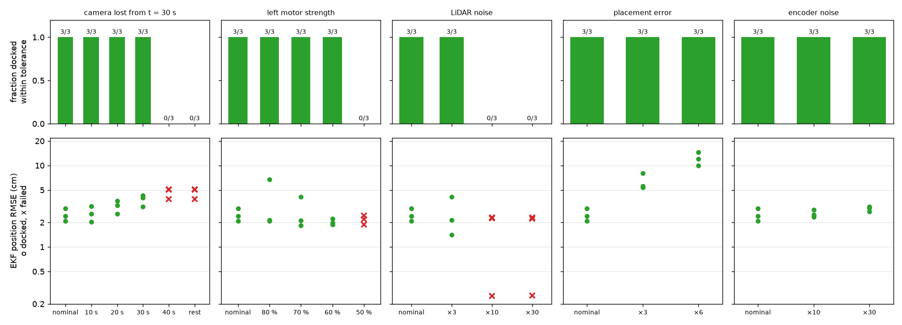

# Part E robustness study

Made by `python -m part_e_integration.robustness`, with Part B's measured R in the EKF. Full pipeline with the rendered camera; seeds 500, 501, 502 (north +10, south +20) in every row, each with a random 2 cm / 1.5° placement error the EKF is not told about. Success = docked within 3 cm along, 2 cm sideways and 3° (true pose), with no collision.

| Condition | Level | Docked OK | EKF position RMSE (cm) | Odometry RMSE (cm) | Mean NEES | Sideways at the dock (cm) | Camera fixes | Camera readings rejected | Time (s) | Failures |
|---|---|---|---|---|---|---|---|---|---|---|
| nominal | west | 3/3 | 2.49 | 4.66 | 1.43 | 0.10 | 328 | 2 | 74 | none |
| nominal | north | 3/3 | 2.83 | 7.74 | 1.49 | 0.03 | 322 | 4 | 67 | none |
| nominal | south | 3/3 | 4.74 | 15.06 | 1.54 | 0.22 | 175 | 2 | 44 | none |
| camera lost from t = 30 s | 10 s | 3/3 | 2.59 | 4.15 | 1.14 | 0.06 | 307 | 1 | 75 | none |
| camera lost from t = 30 s | 20 s | 3/3 | 3.14 | 4.67 | 0.46 | 0.09 | 147 | 1 | 73 | none |
| camera lost from t = 30 s | 30 s | 3/3 | 3.82 | 4.68 | 0.31 | 0.30 | 93 | 0 | 72 | none |
| camera lost from t = 30 s | 40 s | 0/3 | 4.66 | 4.66 | 0.22 | 6.87 | 0 | 0 | 72 | seed 500: docked 7.2 cm sideways; seed 501: docked 5.4 cm sideways; seed 502: docked 8.0 cm sideways |
| camera lost from t = 30 s | rest of run | 0/3 | 4.66 | 4.66 | 0.22 | 6.87 | 0 | 0 | 72 | seed 500: docked 7.2 cm sideways; seed 501: docked 5.4 cm sideways; seed 502: docked 8.0 cm sideways |
| left motor strength | 80 % | 3/3 | 3.64 | 4.34 | 4.77 | 0.60 | 298 | 99 | 78 | none |
| left motor strength | 70 % | 3/3 | 2.68 | 3.96 | 2.28 | 0.94 | 356 | 29 | 77 | none |
| left motor strength | 60 % | 3/3 | 2.03 | 3.66 | 1.67 | 1.40 | 424 | 3 | 80 | none |
| left motor strength | 50 % | 0/3 | 2.17 | 3.70 | 1.55 | 2.21 | 431 | 3 | 81 | seed 500: docked 2.1 cm sideways; seed 501: docked 2.3 cm sideways; seed 502: docked 2.2 cm sideways |
| LiDAR noise | ×3 | 3/3 | 2.55 | 4.98 | 0.90 | 0.02 | 256 | 1 | 84 | none |
| LiDAR noise | ×10 | 0/3 | 1.60 | 1.60 | 0.15 | – | 0 | 0 | 150 | seed 500: stopped 5.0 m from the dock (duration limit); seed 501: stopped 5.1 m from the dock (duration limit); seed 502: stopped 5.0 m from the dock (duration limit) |
| LiDAR noise | ×30 | 0/3 | 1.59 | 1.59 | 0.14 | – | 0 | 0 | 150 | seed 500: stopped 5.0 m from the dock (duration limit); seed 501: stopped 5.1 m from the dock (duration limit); seed 502: stopped 5.0 m from the dock (duration limit) |
| placement error | ×3 | 3/3 | 6.33 | 12.99 | 2.39 | 0.22 | 276 | 1 | 71 | none |
| placement error | ×6 | 3/3 | 12.16 | 23.67 | 6.81 | 0.39 | 284 | 2 | 73 | none |
| encoder noise | ×10 | 3/3 | 2.56 | 4.88 | 1.73 | 0.09 | 347 | 1 | 73 | none |
| encoder noise | ×30 | 3/3 | 2.94 | 5.61 | 3.35 | 0.08 | 339 | 9 | 75 | none |

42 of 57 trials docked within tolerance.

